## 概览

- 信号名称
	- 当一个信号名带`n`后缀说明该信号为低电平有效；
	- 前缀
		- AHB信号：**H** —— 表示一个AHB信号，例如：`HREADY`*等；
		- ASB信号：
			- **A**：ASB 主机和仲裁器之间的单向信号；
			- **B**：表示一个 ASB 信号；
			- **D**：表示一个单向 ASB 译码器信号；
			- 例如`BnRES` 为ASB复位信号，且低电平有效。
		- APB信号：**P** —— 表示一个APB信号，例如：`PCLK`*等；
- 一个典型的AMBA总线系统
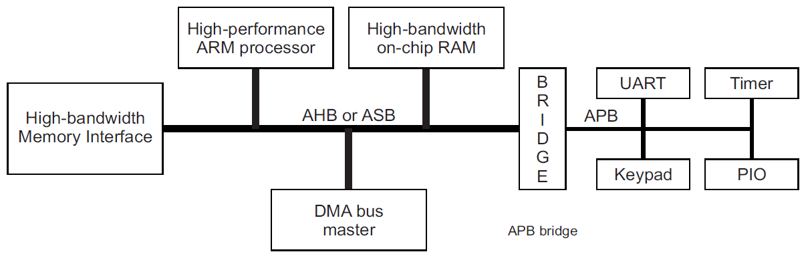

##  APB总线

### 概览

- APB(The Advanced Peripheral Bus)高级外设总线是AMBA(The Advanced Microcontroller Bus Architecture)高级微控制器总线体系的总线层次的一部分，并且**为了降低功率消耗和接口复杂性做了优化**。
- 用于低带宽，对速度要求不高的场景，该场景不需要任何高性能通道总线接口。
- 优点：
	- Low power；
	- Latched address and control（锁存地址和控制）；
	- Simple interface；
	- Suitable for many peripherals。

### 主机与从机（Master和Slave）

时钟：
1. Master发送clk给Slave
```
示意图
 -------------                -------------
|             |              |             |   
|  Master     |CLK---------->|  Slave      |    
|             | -|  |--|  |- |             |
|             |  |__|  |__|  |             |
 -------------                -------------
```

2. 外部提供时钟给Master和Slave
```
示意图
-            --|  |--|  |--|  |
-              |__|  |__|  |--|               
 -------------        |CLK     -------------
|             |       |       |             |   
|  Master     |<------------->|  Slave      |    
|             |               |             |
 -------------                 -------------
```

- Master
	- 主机是传输过程中的掌控者（无论是RD还是WR）
		- WR时：Master -> Slave 发送addr、data和flag信号，直到Slave返回ack后结束；
		- RD时：Master -> Slave 发送读请求，Slave返回读数据后结束；
- Slave
	- 从机是传输过程中的受控者（无论是RD还是WR）
		- WR时：Slave接收Master发送的data、addr和flag信号，然后返回ack给主机；
		- RD时：Slave等待Master发送读请求，Slave返回读数据后从机任务完成；
- 小结
	- APB传输都由Master发起，Slave被动配合；
	- 同一套APB传输过程，APB一般一主多从，通过PSELx信号控制传输的从机；
	- 无论WR还是RD，APB主机必须直到传输是否结束；
	- APB主机通过Pwrite信号区分读写传输（1写0读）

### 信号列表

|    名称     |         信号来源         |                                                 描述                                                  |
| :-------: | :------------------: | :-------------------------------------------------------------------------------------------------: |
|  `PCLK`   |     Clock source     |                                     总线时钟。PCLK 的上升沿用作所有APB传输的时基。                                     |
| `PRESETn` | System bus equipment |                                     APB复位。低有效，该信号直接连到系统总线复位信号。                                      |
|  `PADDR`  |      APB bridge      |                                     APB地址总线。32bit并由外设总线桥接单元驱动。                                      |
|  `PSELx`  |      APB bridge      |                             片选信号。指向特定从机，每个从机都有一个该信号，某个`PSELx`拉高则该从机被选择。                             |
| `PENABLE` |      APB bridge      |                                     APB选通。此信号指示APB传输的第二个及后续周期。                                      |
| `PWRITE`  |      APB bridge      |                                       APB传输方向。'1’进行写，'0'进行读。                                        |
| `PWDATA`  |      APB bridge      |                                   写数据总线。`PWRITE`为1时驱动，可达32bit宽度。                                    |
| `PREADY`  |   Slave interface    |                                      准备信号。从机向主机发出该信号证明传输准备就绪。                                       |
| `PRDATA`  |   Slave interface    |                                   读数据总线。`PWRITE`为0时驱动，可达32bit宽度。                                    |
| `PSLVERR` |   Slave interface    |                                      表示传输失败。外设可能不包含该引脚，主机可以拉低。                                      |
|  `PSTRB`  |      APB bridge      | 写选通信号。一般4bit，每一bit对应写入地址1byte。例如，`PWDATA`发送了32‘h12345678，通过赋值`PSTRB`为4'b0110，则只传输中间2byte也就是16’h3456 |
通过AMBA总线系统上可以看出，一个完整系统实际作为APB协议主机的是APB bridge而不是CPU，CPU通过APB bridge与多种低速外设相连。

### 时序

#### 状态图

- IDLE :`PSELx` = 0 ;`PENABLE` = 0 若不传输，回到IDLE状态；若传输，到SETUP状态；
- SETUP :`PSELx` = 1 ;`PENABLE` = 0  先将片选信号拉高，再在下一状态拉高选通信号；
- ENABLE : `PSELx` = 1 ;`PENABLE` = 1 若不传输，回到IDLE状态；若传输，到SETUP状态；

#### 写操作

##### 无等待写传输

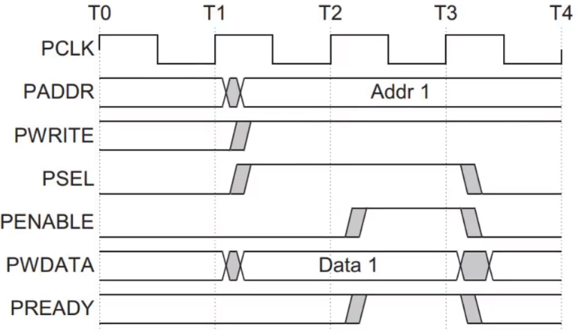

- 在PSEL信号发出时，PADDR、PWDATA、PWRITE(1)信号必须准备就绪，这意味着在从机选通后立马能够进行相应地址的数据写入；紧接着PSEL的下一个时钟周期，PENABLE拉高，从机接收到写入信号并立马返回PREADY，T3时刻，PSEL、PENABLE、PREADY三者同时处于高电平，证明此次传输完成。（单bit但是双平行线部分意味着该信号当前0/1皆可，黑色部分为t_co等寄存器延迟）

##### 有等待写传输

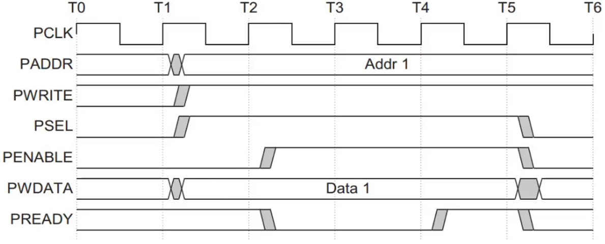

- 在PSEL信号发出时，PADDR、PWDATA、PWRITE(1)信号必须准备就绪，这意味着在从机选通后立马能够进行相应地址的数据写入；紧接着PSEL的下一个时钟周期，PENABLE拉高，从机此时繁忙，故接收到写入信号并未立马返回PREADY，直到T5时刻，PSEL、PENABLE、PREADY三者同时处于高电平，此次传输才算完成。

##### 无等待读传输

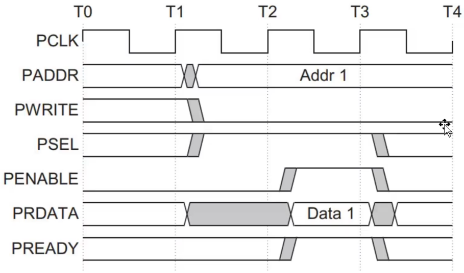

- 在PSEL信号发出时，PADDR、PWRITE(0)信号必须准备就绪，这意味着在从机选通后立马能够进行相应地址的读操作；紧接着PSEL的下一个时钟周期，PENABLE拉高，从机接收到读出信号并立马返回PREADY和PRDATA，T3时刻，PSEL、PENABLE、PREADY三者同时处于高电平，证明此次传输完成。
### 四字节对齐

- APB总线的读写地址一般都是32bit位宽，也就是可以支持从地址32'h0000_0000到地址32'hffff_ffff的访问，每一个地址对应8bit的数据位宽。其对应的数据容量是：$2^{32}×8bit$=$2^{10}×2^{10}×2^{10}×2^{2}×8bit$ = $1K×1K×1K×4×8bit$ =4GB

>手撕代码[[APB_code]]

##  AHB总线

- 前瞻：APB总线由于需要PENALBE和PSEL信号无法保持长时间高电平，故最快需要两个时钟周期来传输一个数据，带宽不足且无法做到突发传输；传输效率低下导致AHB总线的衍生，支持简单burst传输，但是传输速度仍无法和AXI总线比拟。
- AHB总线支持多总线主机和提供高带宽操作的高性能总线。AHB连接的各个模块都可以作为主机发送信号控制APB连接的各个外设从机。
- AHB实现了高性能高时钟频率系统的以下特征要求：
	- 突发传输；
	- 分块处理；
	- 单周期总线主机移交；
	- 单时钟沿操作；
	- 非三态执行；
	- 更宽的数据总线架构（64位或128位）；
- AHB系统设计包含的成分：
	- AHB主机 —— 通过addr和control发送WR操作，任一时刻只允许一个总线主机处于有效状态并使用总线；
	- AHB从机 —— 在给定addr范围内响应WR操作，将成功、失败或等待数据传输的信号返回给**有效**主机；
	- AHB仲裁器 —— 确保只有一个总线主机被允许发起数据传输；（必须只有一个）
	- AHB译码器 —— 对每次传输进行地址译码并且传输中包含一个从机选择信号；

### AHB模块框图

- Manager作为主机，负责发起WR操作，输出信号写数据`HWDATA`、地址`HADDR`；
- Decoder为地址译码器，会根据HADDR的高几个bit来输出片选信号选择下属/从机；
- MUX为多路复用器，同样根据Decoder的输出多路选择器控制信号，控制返回那一个从机的读数据。
- Subordinate1/2/3为下属/从设备，共享写数据总线和地址总线，独立片选信号决定当前是否响应总线操作。

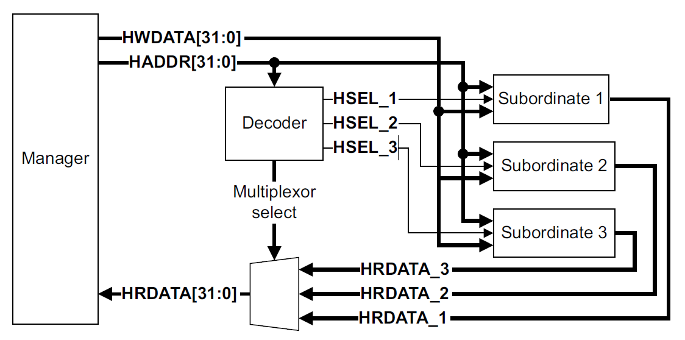

### HADDR控制从机例子

>假设HADDR的数据位宽为10bit，一共有4个从机，那么控制4个AHB从机的地址范围分别为：
>`[0:255]`——从机1；`[256:511]`——从机2；`[512:767]`——从机3；`[768:1023]`——从机4

对应二进制范围：
- 通过`HIADDR[9:0]`地址对下游的四个AHB从机进行地址划分，将其地址平均划分成四个相等的区域。
	1. `HADDR[9:0]=00_00000000 ~ 00_11111111`访问的第一个从机
	2. `HADDR[9:0]=01_00000000 ~ 01_11111111`访问的第二个从机
	3. `HADDR[9:0]=10_00000000 ~ 10_11111111`访问的第三个从机
	4. `HADDR[9:0]=11_00000000 ~ 11_11111111`访问的第四个从机

### 信号梳理

#### Global signal全局信号

- `HCLK`：时钟信号，控制所有总线传输，上升沿有效。
- `HRESETn`：低电平复位系统和总线，

#### Manager signal主机信号

- `HADDR[N-1:0]:`AHB总线读写地址信号，位宽建议为10bit-64bit。
- `HSIZE[3-1:0]:`AHB总线传输数据大小的控制信号，控制每次读写数据大小。
	- 000->8bit(Byte)；
	- 001->16bit(Halfword)；
	- 010->32bit(Word)；**常用**
	- 依次类推直到111-> 1024bit；
- `HPROT[N-1:0]:`AHB总线保护传输信号，N可以被设置成1、4、7，在特殊情况如：系统安全、数据一致性、性能优化等条件发挥作用。
- `HBURST[N-1:0]:`AHB总线的突发设置信号，信号位宽N常设置为1或3。
	- `0b000、0b001`分别为SINGLE（单次突发传输）和INCR（未定义递增突发）；
	- `0b010~0b111`分别为WRAP4、INCR4、WRAP8、INCR8、WRAP16、INCR16；对应n拍回环突发传输和n拍增量突发传输。
- `HWRITE[0:0]:`AHB读写控制信号，1写0读。
- `HWDATA[N-1:0]:`AHB读写数据信号，数据位宽为N，一般为$2^{3}-2^{10}$`bit`，表示写数据。
- `HWSTRB[(N/8)-1:0]:`AHB写数据掩码信号，每个bit控制一个字节数据，1写入0锁住。
	- 例如：若`HSIZE`为010，每次传输4个字节，写地址为000还是003都会一次更改4个地址32bit的数据；倘若希望修改其中一个地址的一个字节数据，要么先读出之前数据（读之前并无记忆功能），再将其他三个字节数据替换成原数据，但这样操作繁琐；故使用掩码信号即可解决这一情况。
- `HTRANS[1:0]:`AHB传输类型，00表IDLE、01表BUSY、10表NONSEQ（非连续）、11表SEQ（连续）。

> AHB总线实际上是一个**半双工通信**，读写公用HADDR，无法同时进行读写，需要通过HWRITE来判断此时的读写操作。此后AMBA公司推出AXI总线协议支持全双工通信。
> AHB总线完成一次读数据或写数据传输**至少需要2个时钟周期**，且只有当从机返回`HREADY`信号微高电平时写入才完成，这是和AXI总线不同的原因。

- `HMASTLOCK[1-1:0]:`AHB总线的主机锁定信号。1表传输锁定，0表示传输正常非锁定。
- `HMASTLOCK`经典应用 —— 原子操作（Atomic Operation）
	- 定义：指一个或多个指令的序列，这个序列作为一个不可分割的单元执行。序列内的操作要么全部执行，要么一个都不执行。执行过程中不被线程调度机制打断，也不会被其他线程或进程中断。
- 为什么需要信号`HMASTLOCK`？
	- 背景：一个主设备的AHB系统中，可能有多个主设备竞争共享资源（如一片共享内存）。
	- 若没有保护机制：当A进行“自增”操作时，从共享内存地址取值a，在CPU内部修改为a+1；再将a+1写回，若在设备A读完但未写回的间隙，主设备B枪战总线并向同一内存地址完成写入操作b，则B写入的b会被A覆盖成a+1，数据完整性遭到破坏。
	- `HMASTLOCK`信号防止数据冒险，当主设备执行“读”修改“写”序列时，主设备发起读传输时**拉高**`HMASTLOCK`信号，接下来的修改和写操作，主设备**持续拉高**`HMASTLOCK`，仲裁器Arbiter监测到该信号为高，将不会允许其他主设备抢占总线，当前锁定主设备将持续拥有总线使用权直到原子操作序列完成并**拉低**`HMASTLOCK`信号，这就保证读写操作序列连续，不可分割。即“原子性”，确保数据一致性。
- 其他信号
	- `HNONSEC[0:0]:` AMBA5.0引入新信号，在硬件总线层面区分安全和非安全传输；
	- `HEXCL[0:0]:`AHB总线的排他性访问信号，支持排他性传输，实现硬件级互斥锁或信号量提供原生支持。
	- `HMASTER[N-1:0]:`由仲裁器产生并广播给整个系统的控制信号，N最大为8。一般都是以唯一地标识系统中每一个可能获得总线授权的主设备。若4个主机，此时00主机有权使用总线，则Arbiter会向4个主机同时发送00信号已告知目前有权访问总线的主机。

#### Subordinate signal从机信号

- `HRDATA[N-1:0]:`AHB总线的读数据信号，数据信号位宽为N，一般为8bit-1024bit；
- `HREADYOUT[1-1:0]:`AHB从机的返回信号，表示从机的握手信息（1完成/0延迟）；
- `HRESP[1-1:0]:`AHB从机的返回信号，表示从机的返回状态（1失败/0成功）；
	- AMBA2.0版本为2bit，00-11分别代表OKEY、ERROR、RETRY 和SPLIT。
- `HEXOKAY[1-1:0]:`这是AHB5协议新增的信号，专门用于配合排他性访问。

#### Decoder signals译码器信号和Multiplexor signals复用器信号

- `HSELx[0:0]:`AHB总线的译码器输出信号；
- 多个AHB从机输出的`HRDATA`、`HREADYOUT`、`HRESP`、`HEXOKAY`都先经过多路复用器，根据`HADDR`的高位根据译码器产生的`HSELx`信号选择的从机，从而选择从机的输出返回给主机。

### 时序说明

#### 基本传输

一、基本读时序

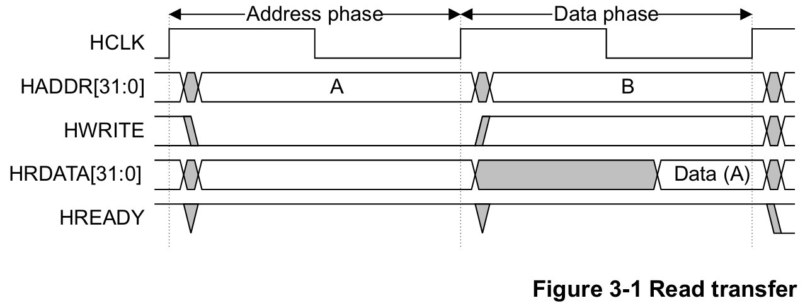

时序说明：基本无等待的读操作需要分两个阶段，每个阶段至少需要一个时钟周期：
1. 阶段1 —— 地址阶段：此时主机发出读地址`HADDR`，并拉低`HWRITE`信号表明此次为读操作；
2. 阶段2 —— 数据阶段：当主机接收到从机发出的`HREADY`信号拉高时，主机接收从机给出的读数据信号`HRDATA`，读出Data(A)。

二、基本写时序

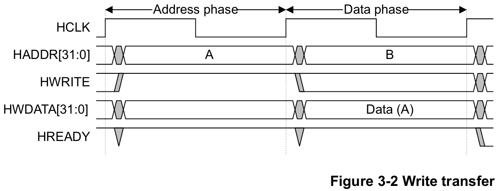

时序说明：基本无等待的写操作同样需要分两个阶段，每个阶段至少需要一个时钟周期：
1. 阶段1 —— 地址阶段：此时主机发出写地址`HADDR`，并拉高`HWRITE`信号表明此次为写操作；
2. 阶段2 —— 数据阶段：当主机接收到从机发出的`HREADY`信号拉高时，主机接收从机给出的写数据信号`HWDATA`，写入Data(A)。

小结：
1. Master在HCLK上升沿将`HADDR`和`HWRITE`驱动到总线上；
2. Slave随后在下一个上升沿采样`HADDR`和`HWRITE`；
3. Slave采样后驱动相应的`HREADYOUT`响应，该响应将被Master在HCLK第三个上升沿采样；
4. 传输的地址阶段和数据阶段在不同时钟周期以便流水线操作；
5. 每个Slave都有一个在数据阶段驱动的`HREADYOUT`信号，这些信号将被组合产生信号`HREADY`。

三、两个等待周期的读传输

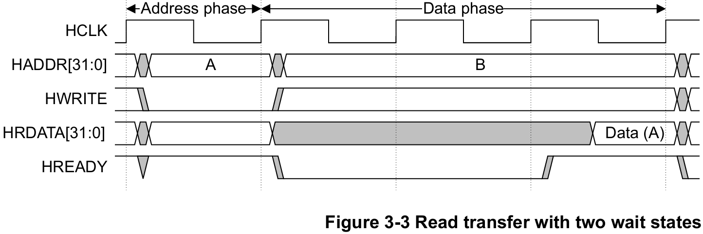

时序说明：在数据阶段，从机没有立刻拉高`HREADY`信号，这意味着从机此时处于忙碌状态；等待两个时钟周期后`HREADY`拉高，此时从机发出读数据`HRDATA`给主机。

四、一个等待周期的写传输

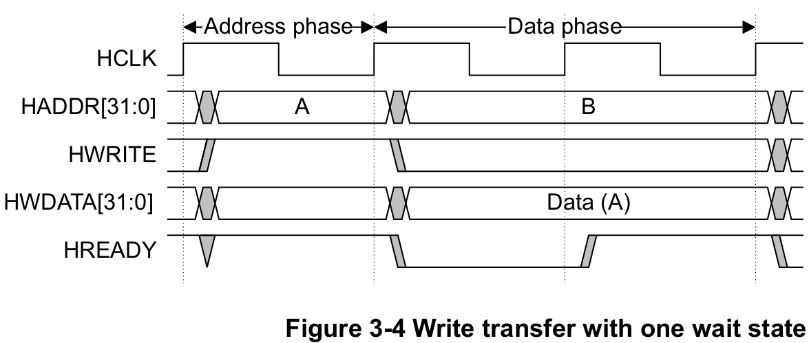

> Slave可以在任何传输中插入等待状态，以便为完成提供额外时间。

五、多次传输

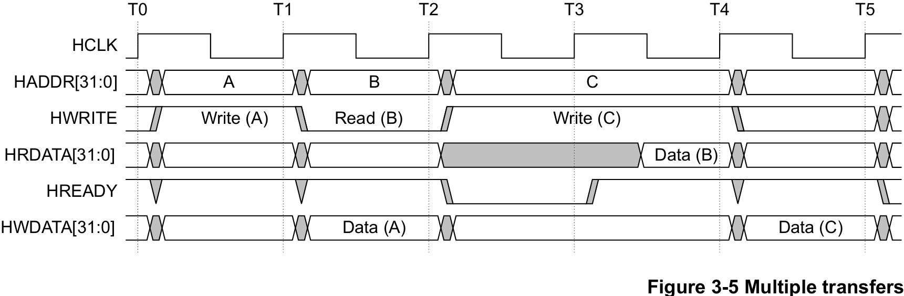

时序说明：
1. T1时钟，主机发出写请求，向地址A进行写操作；
2. T2时钟，主机将数据Data(A)通过HWDATA端口写入；同时主机发出读请求，向地址B进行读操作；
3. T3时钟，从机繁忙，`HREDAY`信号始终拉低；主机发出写请求，向地址C进行写操作；
4. T4时钟，从机拉高`HREDAY`信号，并将数Data(B)通过`HRDATA`端口发送给主机；主机保持上一个时钟的行为：发出写请求，向地址C进行写操作；
5. T5时钟，主机将数据Data(C)通过HWDATA端口写入；

#### 不同传输类型

- `HTRANS[1:0]` —— AHB传输类型
	1. IDLE：总线主机没有要进行的传输；一般主机使用IDLE终止已锁定的传输；从设备应忽略本次传输，返回零等待OKAY响应。
	2. BUSY：由主机用来在突发传输序列中插入等待状态，BUSY结束继续执行突发传输；忙状态同样被从机忽略；**只有INCR才能在最后一个周期使用BUSY传输，固定长度传输必须以SEQ结尾**；主机**不允许**SINGLE单次突发后立即执行BUSY传输，必须接IDLE或NONSEQ。
	3. NONSEQ（非连续）：一次突发传输的第一个传输，或者一个单次传输。这表示地址与控制信号与上一次传输没有连续关系，即单个地址传输。
	4. SEQ（连续）：突发传输中第一个之后的传输，地址与上一次传输是连续的(根据`HSIZE`和`HBURST`计算得出)。从机可以利用这个信息进行提前预取等优化，加快AHB的传输效率。

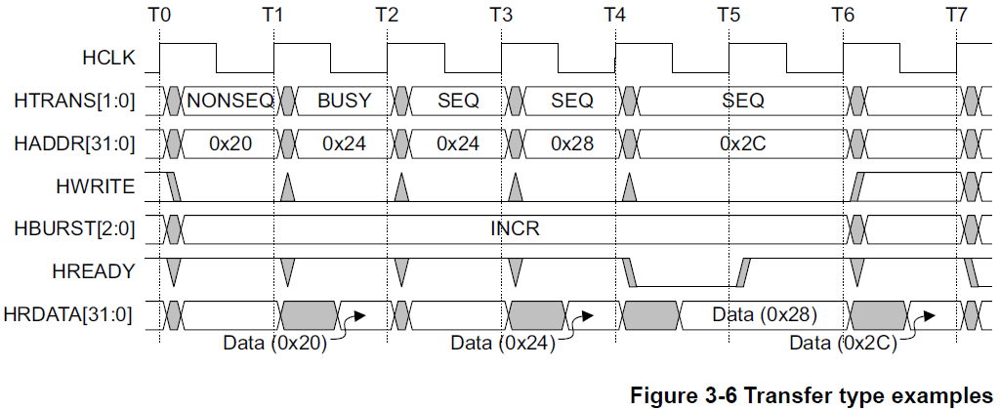

时序说明：
1. 默认`HSIZE`为word，即每次传输一个字四个字节，那么地址每次增加4bit；
2. T0-T1：第一个数据传输，传输以NONSEQ非连续传输开始，主机对地址0x20进行读操作；
3. T1-T2：**主机繁忙**，插入BUSY状态延迟第二拍，虽然地址切换至0x24且`HWRITE`拉低，但是从机将忽略本次读操作；`HREADY`拉高，握手成功，从机返回第一拍的读数据Data(0x20)；
4. T2-T3：主机准备好开始第二拍，发出SEQ连续传输信号，地址将每次4bit递增，`HWRITE`拉低，主机进行对0x24地址的读操作；由于上一时刻为BUSY状态，主机**忽略**从机在读数据总线上**返回的任何数据**；
5. T3-T4：传输状态保持SEQ连续传输，地址将做4bit递增，主机执行第三拍传输，从机通过`HRDATA`返回第二拍的读数据Data(0x24)；
6. T4-T5：传输状态保持，地址做4bit递增，主机执行第四拍传输；但**从机繁忙**，`HREADY`拉低等待一个状态；
7. T5-T6：主机保持执行第四拍传输，从机返回第三拍的读取数据；
8. T6-T7：从机返回第四拍读数据。

#### 不同突发类型

一、WRAP4 —— 4拍回环突发

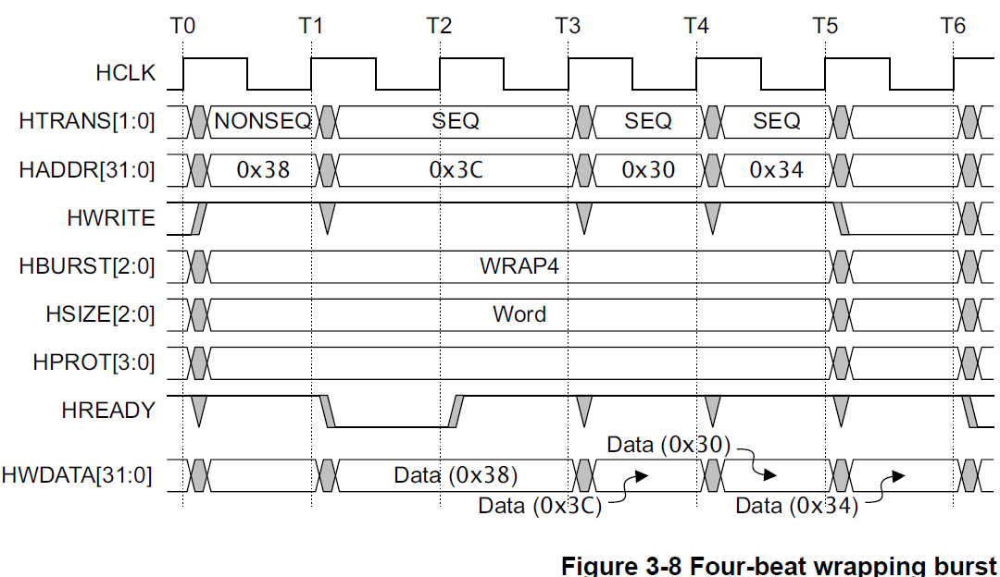

- **回环突发**有着自己的地址区间，如图为例，地址空间为0x30~0x3F，0x3C结束后会回到0x30，而不是跳转到下一个地址空间0x40~0x4F。
- **地址空间**取决于`HSIZE`和`HBURST`：传输大小`HSIZE`设置为010意味着每次传输1word = 4Byte = 32bit；每一个Byte数据需要1bit地址；突发类型`HBURST`设置为010为4拍回环突发，4拍传输，每拍32bit数据，4bit地址，地址空间为4×4=16bit。
- 虽然第二次传输`HADDR`地址为0x3C，但是这次传输会写满0x3C~0x3F这4bit地址的空间。
- 常用于cache。

二、INCR4 —— 4拍增量突发

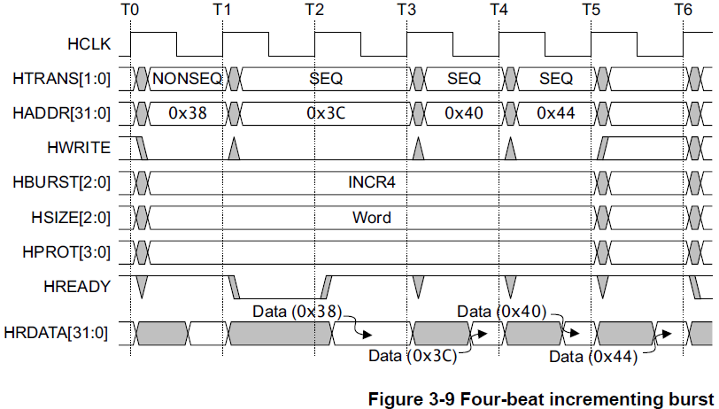

- **增量突发**每次按照`HSIZE`传输大小，增加对应的地址值（4Byte数据对于4bit地址）。

三、WRAP8 —— 8拍回环突发

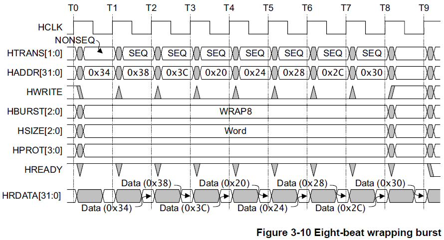

- **8拍回环突发**：每次突发传输32Bytes数据，地址空间大小为32bits，第一地址空间为0x00~0x1F；第二地址空间为0x20~0x3F，后续依此类推。
- `HADDR`每次递增大小取决于`HSIZE`的设置，`Word 32bit -> 4Bytes Data => 4bit Addr；`

四、INCR8 —— 8拍增量突发

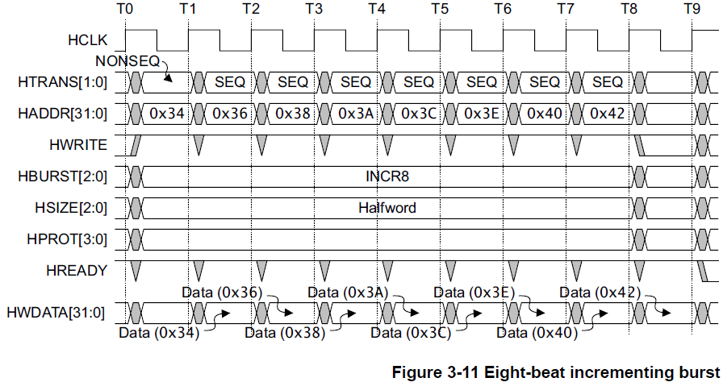

- `HSIZE`设置为Halfword半字，即数据传输大小为16bit/2Byte；故`HADDR`每次递增2bit。

五、不定长突发

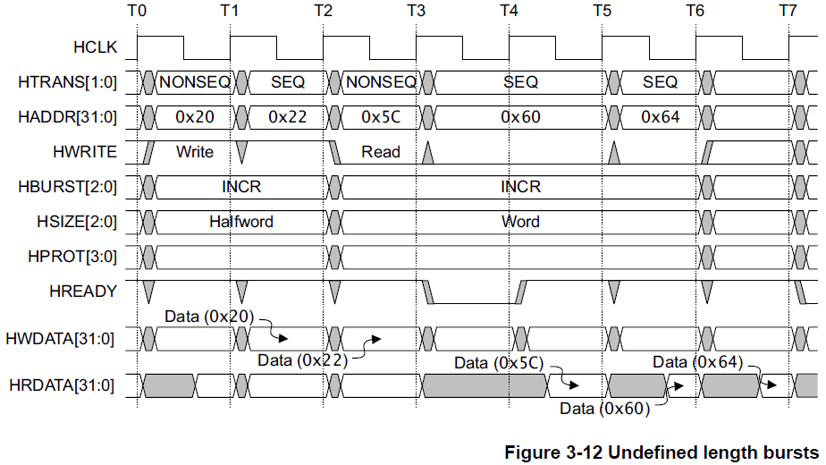

- 分两段增量突发，突发类型都是INCR未定义（不定长）增量突发：
	- 第一次为写操作，首次突发地址为0x20，`HTRANS`以`NONSEQ`开头，`SEQ`结尾；
	- 第二次为读操作，首次突发地址为0x5C，往后依次按4bit递增，`HTRANS`同样以`NONSEQ`开头，`SEQ`结尾；T3~T4从机繁忙，HREADY拉低；T4~T5，HREADY拉高，握手成功，从机返回前一拍读数据0x5C。

六、IDLE传输

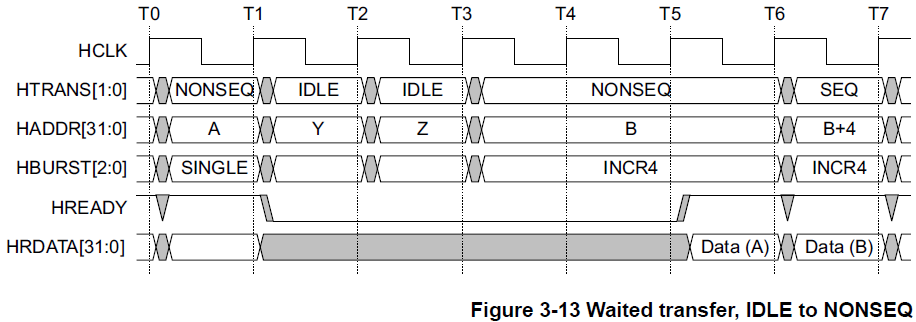


- T0~T1：主机发起单次突发访问地址A；
- T1~T3：传输状态跳转到IDLE，从机拉低`HREADY`，进入等待状态；从机将忽略地址Y和Z；
- T3~T5：主机发起新一轮4拍增量传输，但从机仍拉低`HREADY`，`HRDATA`将不会有具体数据，主机需要保持`HTRANS`、`HADDR`、`HBURST`信号；
- T5~T6：从机拉高`HREADY`，从机返回T0~T1数据Data(A)；
- T6~T7：正常进行4拍增量传输，从机返回上一拍数据Data(B)。

七、BUSY传输

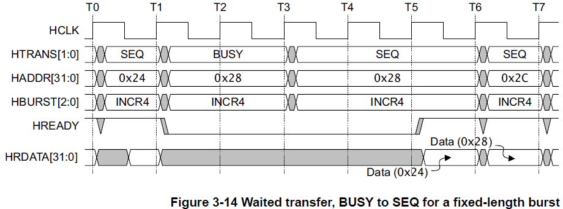

- 4拍增量突发的某一时刻，主机繁忙插入BUSY状态，从机拉低`HREADY`信号；恢复传输，传输状态重新回到SEQ，待从机拉高`HREADY`信号后，从机返回BUSY状态前一个时钟周期地址的数据Data(0x24)。
- 恢复传输，地址和突发类型保持一致，读数据仍保持地址连续递增。

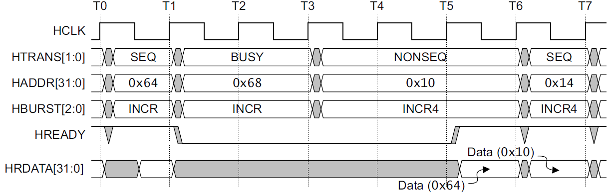

- 未定义增量突发某一刻，主机繁忙插入BUSY状态，从机拉低`HREADY`信号；恢复传输，主机发起新一轮4拍增量突发传输，传输状态以NONSEQ开头，待从机拉高`HREADY`信号后，从机返回BUSY状态前一个时钟周期地址的数据Data(0x64)。
- 恢复传输，主机发起新一轮传输，BUSY状态的地址将被忽略。
> 总结：恢复传输的下一个时钟周期，从机返回的`HRDATA`始终为恢复传输时的地址数据。

>手撕代码[[code/AHB_code]]