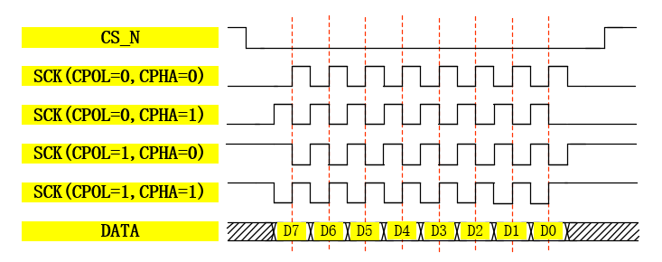

## 几个概念

- 同步通信和异步通信：
	- 同步：tx发送，等rx响应后才发下一个数据包； **以SPI、IIC为例**
	- 异步：tx发送后，不等rx响应，直接着发送下个数据包。 **以UART为例**
	- **USART**为同步&异步通信。
- 单工、全双工、半双工：
	- 单工：单个方向传输，开始时就定义好传输方向，无法更改；
	- 半双工：传输方向可切换，允许数据在两个方向上传输，但同一时间只能一个方向上传输，可以基本双向通信；
	- 全双工：允许数据同时在两个方向传输。发送和接收完全独立，在发送的同时可以接收信号，反之同理。要求rx和tx都要有独立的发送和接收能力，
## UART协议

### 协议原理

- 概念：UART(Universal Asynchronous Receiver/Transmitter) —— 通用异步收发传输器，是一种异步收发传输器
- 特点：
	- 数据发送时将**并行data转换成串行数据传输**，可实现全双工传输和接收；
	-  UART时异步串行通信的总称，包含RS232、RS449、RS423、RS485等标准；
	- TTL电平与RS232电平：
		- TTL电平：逻辑1 -> 3.3V/5V；逻辑0 -> 0V；
		- RS232电平：逻辑1 -> 3V~13V；逻辑0 -> -3V~-13V；
		- 相较之下RS232抗干扰能力更强；
		- 数据包组成：
			- 起始位：**一般为'0'**；
			- 数据位：可为5、6、7、8位长；
			- 校验位：防止干扰，加上数据校验位；
				- 校验方法有：奇校验（**奇数个1输出0** 实现形式-偶校验取反）、偶校验（**偶数个1输出0** 实现形式为：按位缩进异或 even=^a）、0/1校验、无校验；
				- 为什么是0这一直觉：给定数据中1的个数是奇数，那么偶校验为1，使得1的总数为偶数；反之1个数为偶数，则奇校验为1，使得1的总数为奇数。
			- 停止位：可由0.5、1、1.5、2个逻辑'1'表示；
			- 波特率：由于异步双工，uart无时钟线，通讯双方需要约定好波特率这一码元长度，以便对信号解码。

```
示意图
 ----------                -----------
|       RXD|----->----->--|TXD        |   RXD：数据接收引脚，即input
|       TXD|-----<-----<--|RXD        |   TXD：数据发送引脚，即outout
|       GND|--------------|GND        |   GND：二者公共地
 ----------                -----------
```

- 可能还会有信号RTS —— 请求发送信号；CTS —— 允许发送信号； 
- 代码：具体代码查看笔记[[uart_code]]

## IIC协议

### 原理

- 概念：I2C通信协议(Inter-Integrated Circuit) 是Philips公司开发的一种简单同步、双向二线制串行总线，只要两根线（其实还需要GND）即可传送信息；

设备连接图如下：


- 特点：
	1. 支持多主多从，从机都有独立地址，多主机使用会采取仲裁方式决定某一设备占用总线；
	2. 一个I2C总线有两条线路：双向串行数据线SDA，串行时钟线SCL；
	3. 总线通过上拉电阻接电源，空闲时输出高阻态；
	4. 三种传输模式：标准100kb/s，快速400kb/s，高速3.4Mb/s；

### 协议层

协议整体时序图：


- 分四个部分：IDLE、START、WR/RD、STOP：
	- IDLE：此时SCL、SDA均为高电平，无I2C设备工作；
	- START：总线空闲 —— SCL为高，单SDA产生起始信号，从设备检测此信号跳出空闲状态等待控制字节输入；
	- WR/RD：通讯分主从之分：
		- 主机向从机写：SDA在SCL为高时写，每次写入1bit；SDA在SCL拉低后更新，保证每次SCL拉高后SDA数据稳定；完整字节传输完成，从机拉低SDA响应主机表示写入成功。从机应答则写入成功，结束或下一byte传输，否则写入失败，可以放弃或重写。
	- STOP：SCL保持高电平，SDA也随之拉高，此时产生停止信号，I2C总线跳转空闲状态。

### 器件地址和存储地址

- 器件地址：一般7bit，EEPROM设置好高4bit，低3bit通过设计硬件自主设置，故1个主机最多连接8个AT24C64存储芯片 —— EEPROM芯片。主机发送起始信号后，接着会发送控制命令：1 0 1 0 $A_2$ $A_1$ $A_0$ R/W；从机接收先看前7bit，对比自身地址，二者相同则建立连接；最后一位控制命令控制读写：**0表主对从写、1表从对主读**。
- 存储地址：以AT24C64为例，存储空间为64Kb(8KB)，1个地址存8bit数据(1Byte)，故需要$2^{13}$个数表示，即13位存储地址，故该存储芯片存储地址为2字节。（2Kb/256B存储以内为1字节）。

### 读写操作（粗体主机操作，斜体从机操作）

#### 写操作(R/W为0)

##### 单字节写操作

单字节写指的是数据单字节，所有又可分为单字节存储地址和2字节存储地址。

.png "单字节写操作时序图 (2字节存储地址 )")

流程：
1. **主机发送起始信号START -> 写控制命令（包含器件地址和读写控制位）**，*从机匹配并回传响应信号ack*；
2. **主机向从机写地址**：
	- **单字节从高到低写入存储地址**，*从机响应ack*；
	- **2字节先传高8位**，*从机响应ack*，**再发低8位**，*从机再次响应ack*；
3. **主机向从机写数据，写入单字节**，*从机响应ack* -> **主机发送停止信号STOP**，写入操作完成。

##### 页写操作

- 前半部分同理，也分单双字节存储地址，只是数据可写入多字节，一次发送一个字节，从机相应一次。
- 仅部分设备支持页写操作，AT24CXX系列EEPROM单页存储单元为32个，一次页写可以写入32byte。

.png "页写操作时序图 (2字节存储地址 )")

#### 读操作(R/W为1)

##### 随机读操作

- 图中展示读写两个过程，先写入后读出，写入过程参考上面写操作流程。


紧接着写操作后的流程：
1. **主机再次发送起始信号** -> **发送控制指令**，读写控制位为高电平，*从机回传应答信号ack*；
2. （这里没有传输地址的过程）*从机传回单字节数据*；
3. 数据接收完成，**主机产生一个时钟`无应答信号`**;
4. **主机向从机发送停止信号**，单字节读操作完成。

##### 顺序读操作

- 顺序读就是对寄存器或存储单元数据的顺序读取；读取n字节连续数据，只要读取第一个字节数据的存储地址，接下来自动地址+1进行顺序读取。


具体代码和实现过程查看笔记[[I2C_code]]

> 所有数据无论是存储地址还是读写数据都是先传输最高位！

针对MAX2769C的**3线串行接口**

- 三线接口：CS_N、SCLK、SDATA，类似IIC和SPI结合体，前者SPI有，后者想IIC的SCL和SDA；
- 该协议是一个半双工协议，且一般只用来主机（MCU、FPGA）给从机（射频芯片）写入数据；
- CS_N不像命名是一个片选信号，更像一个使能信号，空闲状态下，该信号为高电平，在传输数据时为拉低，直到数据传输完成；
- SCLK是一个小于20MHz的时钟，FPGA或MCU自行分频得出；
- SDATA帧结构为：首先发送DATA（先发送数据高位再到低位）；然后发送地址位（同样先高后低），对于射频芯片：高28bit为寄存器控制数据、后4bit为地址位。

```
MAX2769C芯片手册P21给出SPI协议下各个时钟约束
tCSS：片选信号下降沿和第一个SCLK时钟上升沿时间不小于10ns；
tDS：SDATA的建立时间 —— 不小于10ns；
tDH：SDATA的保持时间 —— 不小于10ns；
tCH：一个时钟周期内高电平的最小时间为25ns;
tCL：一个时钟周期内低电平的最小时间为25ns;
\\综合tCH + tCL时钟最快为50ns也就是20MHz
tCSH：最后一个SCLK上升沿到CS的上升沿 —— 不小于10ns；
tCSW：片选信号（使能）两次传输间隔 —— 不小于1个clk；
```

## SPI协议

### 原理

- 概念：SPI(Serial Peripheral Interface，串行外围设备接口)通讯协议，又Motorola公司提出的同步串行接口技术，高速、全双工、同步。
- 无应答机制，数据可靠性上与I2C相比有缺陷。

详细实现过程查看笔记[[SPI_code]]

### 物理层

```
示意图
 -------------                -------------
|          SCK|------------->|SCK          |   主机控制产生
|  Master MOSI|------------->|MOSI  Slave  |   主机控制产生
|         MISO|<-------------|MISO         |   从机控制产生
|           CS|------------->|CS           |   主机控制产生
 -------------                -------------
```

- 上图为一主一从示意图，若为一主多从；主机会有多个CS信号输出口CS1、CS2、CS3等，从机则各自分配不同的CS输入端口；其他三个信号共享；
- 信号说明：
	- SCK(Serial Clock)：时钟信号线，用于同步通讯数据，两个设备之间通讯时，通讯速率受限于低速设备（MAX2769C最快时间为25ns * 2 - > 20MHz）；
	- MOSI(Master Output Slave Input)：主设备输出/从设备输入引脚，主机从该端口输出；
	- MISO(Master Input Slave Output)：主设备输入/从设备输出引脚，主机从该端口读入;
	- CS(Chip Select)：片选信号线，也称为CS_N，CS_N用于选址，默认高电平，主机拉低哪个片选信号就选择对应的从机。（**低电平有效**）

### 协议层

#### CPOL/CPHA及通讯模式

- 四种模式由时钟极性(CPOL , Clock Polarity)和时钟相位(CPHA , Clock Phase)来定义.
	- CPOL：规定了空闲状态时SCK时钟信号的电平状态；
	- CPHA：规定了数据采样是在SCK时钟的奇数边沿还是偶数边沿，而数据更新时SCK时钟边沿正好相反。（不是简单的上升沿和下降沿，因为CPOL变，第一个沿是上升还是下降也会改变）
- 四种模式：
	- {CPOL,CPHA} = 00：IDLE时SCK为'0'，数据采样为上升沿，数据更新为下降沿；
	- {CPOL,CPHA} = 01：IDLE时SCK为'0'，数据采样为下降沿，数据更新为上升沿；
	- {CPOL,CPHA} = 10：IDLE时SCK为'1'，数据采样为下降沿，数据更新为上升沿；
	- {CPOL,CPHA} = 11：IDLE时SCK为'1'，数据采样为上升沿，数据更新为下降沿；
	- 第一个和第三个模式比较常用。
 


flash全擦除实验查看笔记[[SPI_code]]