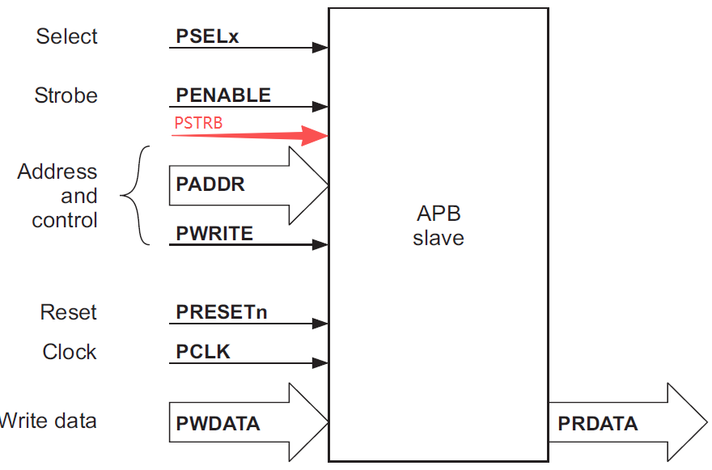
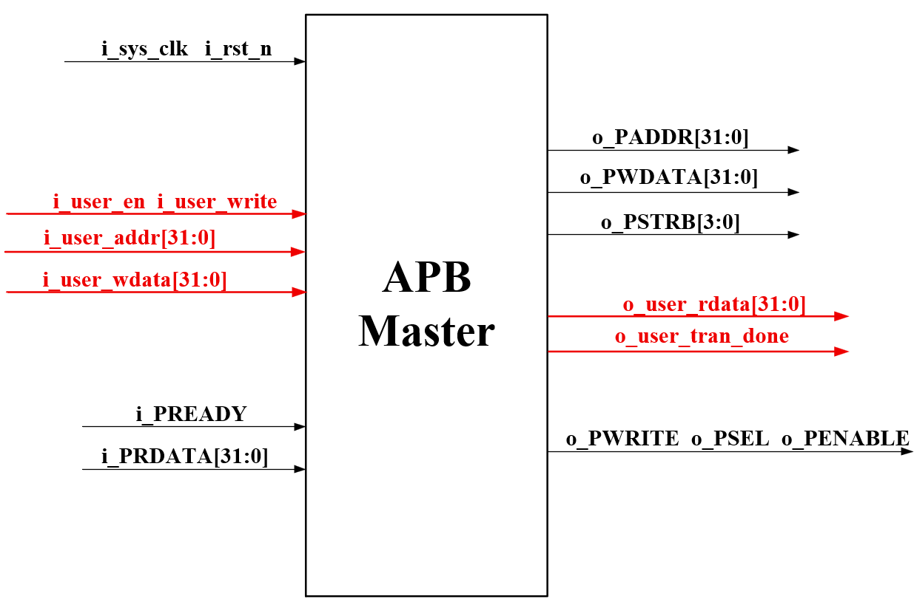
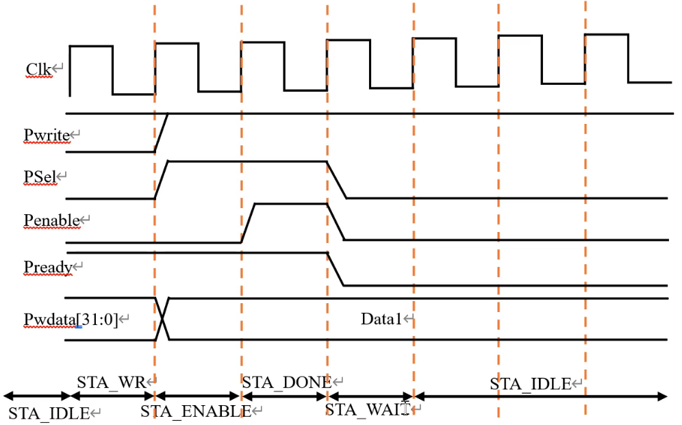
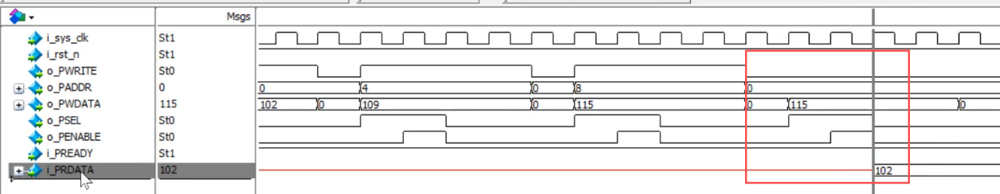

### 从机

#### 整体结构框图




- APB从机内一定存在一个存储介质，用于保存对应地址下的数据。
- 关于写入地址，存放以32bit/4byte为一个单位，而4byte对应4个地址，对这4个地址的读写都会直接覆盖这个32bit的数据，例如：
	`将32'h1111_1111写入0x00`
	`此时对应的操作为: 地址  03     02    01    00`
	`               位数|31  24|23  16|15  8|7  0|`
	`           存放数据0x  11     11    11    11`
	`将32'h2222_2222写入0x01`
	`此时对应的操作为: 地址  03     02    01    00`
	`               位数|31  24|23  16|15  8|7  0|`
	`           存放数据0x  22     22    22    22`
	故在将中间`mem`赋值给`r_rdata`时，写法为`r_rdata <= memory[i_PADDR[31:2]];`舍去后两位正好对应4个地址为1组32bit数据。区分地址和寄存器，地址的0x00-0x03对应memory寄存器的第1个32bit数据，0x04-0x07对应memory寄存器的第2个32bit数据。
	
``` verilog 
module apb_slave(
	//system
	input wire i_sys_clk,
	input wire i_rst_n,
	//APB ctrl
	input [31:0] i_PADDR,
	input [31:0] i_PWDATA,
	input [ 3:0] i_PSTRB,
	input        i_PWRITE,
	input        i_PSEL,
	input        i_PENABLE,
	output wire  o_PREADY,
	output wire [31:0] o_PRDATA
);
reg [31:0] memory [0:1023]; //定义1024×32bit的存储空间
reg [31:0] r_rdata;   //读数据寄存
integer i;
always@(posedge i_sys_clk or negedge i_rst_n)
begin
	if(!i_rst_n)
	begin
		for(i=0;i<1024;i=i+1)begin:memory_initial
			memory[i] <= 32'a5a5a5a5; //a5 = 10100101初始化一个特定有规律值
		end
	end
	else if(i_PSEL && i_PENABLE)
	begin	
		if(i_PWRITE)
		begin
			if (i_PSTRB[0])memory[i_PADDR[31:2]][ 7: 0]<=i_PWDATA[ 7: 0];
			if (i_PSTRB[1])memory[i_PADDR[31:2]][15: 8]<=i_PWDATA[15: 8];
			if (i_PSTRB[2])memory[i_PADDR[31:2]][23:16]<=i_PWDATA[23:16];
			if (i_PSTRB[3])memory[i_PADDR[31:2]][31:24]<=i_PWDATA[31:24];
		end else 
		begin
			r_rdata <= memory[i_PADDR[31:2]];
		end
	end
end

assign o_PREADY = 1'b1;
assign o_PRDATA = r_rdata;
```

### 主机

#### 整体结构框图



- 黑色端口都是Slave实现时已经给出过，其中，除了时钟和复位信号为系统给出，Slave的输入是Master的输出，Slaver的输出为Master的输入；
- 红色端口为用户/CPU发给APB Master的信号：
	- `i_user_en`、`i_user_write`为CPU/用户给主机发起的读写使能和读写操作标识位；
	- `i_user_addr`、`i_user_wdata`为CPU/用户给主机输入的地址和写数据；
	- `o_user_rdata`是Slave传给Master的`i_PRDATA`再回传给CPU的输出数据；
	- `o_user_tran_done`同理，是Master回传给CPU与Slave的读写传输完成指示信号。

#### 时序图

##### 写时序


- 最下面一行将整个协议分为各个状态，STA_WAIT状态作为`o_user_tran_done`信号拉高的条件，且给一个STA_WAIT作为一个传输结束的缓冲状态。
- 状态机状态个数较少，使用独热码来定义各个状态：若使用常规二进制，000 ->011后两bit在电路上可能因为线路延迟不相等的原因出现短暂的010/001，导致状态跳转错误。独热码/格雷码每次跳变只变化一个bit。

``` verilog 
//为了仅展示APB框架和协议，设定user输入信号和i_sys_clk同源（同步/同一时钟域）
module apb_master(
	//system
	input wire i_sys_clk,
	input wire i_rst_n,
	//connect User
	input         i_en,
	input         i_write,
	input  [31:0] i_addr,
	input  [31:0] i_wdata,
	output [31:0] o_rdata,
	output        o_tran_done,
	//connect APB slave
	output  [31:0] o_PADDR,
	output  [31:0] o_PWDATA,
	output  [ 3:0] o_PSTRB,
	output         o_PWRITE,
	output         o_PSEL,
	output         o_PENABLE,
	input wire     i_PREADY,
	input wire [31:0] i_PRDATA
);
/********localparam********/
localparam IDLE = 6'd1;
localparam STA_WR=6'd2;
localparam STA_RD=6'd4;
localparam STA_ENABLE=6'd8;
localparam STA_DONE  =6'd16;
/************reg************/
//connect to APB Slave
reg [31:0] r_paddr ;
reg [31:0] r_pwdata;
reg [ 3:0] r_w_strobe;
reg        r_pwrite;
reg        r_psel;
reg        r_penable;
//connect to User
reg        r_tran_done;
reg [31:0] r_prdata;
/************state************/
reg [5:0] r_cur_sta;
reg [5:0] r_nxt_sta;
//第一段状态机 赋下一状态
always@(posedge i_sys_clk or negedge i_rst_n)begin
	if (!i_rst_n) r_cur_sta <= IDLE;
		else      r_cur_sta <= r_nxt_sta ;
end
//第二段状态机 状态跳转 组合逻辑
always@(*)begin
	if(!i_rst_n) r_cur_sta <= IDLE;
	else begin
		case(r_cur_sta)
			IDLE:
				begin
					if(i_write&i_en)       r_nxt_sta <= STA_WR;
					else if(!i_write&i_en) r_nxt_sta <= STA_RD;
					else                   r_nxt_sta <= r_nxt_sta;
				end
			STA_WR:
				r_nxt_sta <= STA_ENABLE;
			STA_RD:
				r_nxt_sta <= STA_ENABLE;
			STA_ENABLE:
				if(i_PREADY) r_nxt_sta <= STA_DONE;
				else         r_nxt_sta <= r_nxt_sta;
			STA_DONE:
				r_nxt_sta <= STA_WAIT;
			STA_WAIT:
				r_nxt_sta <= IDLE;
			default:r_nxt_sta <= IDLE;
		endcase
	end
end
//第三段状态机 对各个状态时的输出信号赋值 时序逻辑
always@(posedge i_sys_clk or negedge i_rst_n)begin
	if(!i_rst_n) begin
		r_paddr     <=  32'd0;
		r_pwdata    <=  32'd0;
		r_w_strobe  <=  4'b1111;
		r_pwrite    <=  1'b0;
		r_psel      <=  1'b0;
		r_penable   <=  1'b0;
		r_tran_done <=  1'b0;
		r_prdata    <=  32'd0;
	end
	else begin
		case(r_cur_sta)
			IDLE：
				begin
					r_paddr     <=  32'd0;
					r_pwdata    <=  32'd0;
					r_w_strobe  <=  4'b1111;
					r_pwrite    <=  1'b0;
					r_psel      <=  1'b0;
					r_penable   <=  1'b0;
					r_tran_done <=  1'b0;
					r_prdata    <=  32'd0;
				end
			STA_WR:
				begin
					r_paddr <= i_addr;
					r_pwdata<= i_wdata;
					r_pwrite<= 1'b1;
					r_psel  <= 1'b1;
					r_penable <= 1'b0;
				end	
			STA_RD:
				begin
					r_paddr <= i_addr;
					r_pwrite<= 1'b0;
					r_psel  <= 1'b1;
					r_penable <= 1'b0;
				end	
			STA_ENABLE:
				begin
					r_penable <= 1'b1;
				end
			STA_DONE: //释放片选和使能
				begin
					r_psel <= 1'b0;
					r_penable <= 1'b0;
				end
			STA_WAIT:
				begin
					r_tran_done <= 1'b1;
					r_prdata <= i_PRDATA;
				end
			default：
				begin
					r_paddr     <=  32'd0;
					r_pwdata    <=  32'd0;
					r_w_strobe  <=  4'b1111;
					r_pwrite    <=  1'b0;
					r_psel      <=  1'b0;
					r_penable   <=  1'b0;
					r_tran_done <=  1'b0;
					r_prdata    <=  32'd0;
				end
		endcase
	end
end
/************comb组合逻辑******/
assign o_PADDR   =  r_paddr   ;
assign o_PWDATA  =  r_pwdata  ;
assign o_PSTRB   =  r_w_strobe;
assign o_PWRITE  =  r_pwrite  ;
assign o_PSEL    =  r_psel    ;
assign o_PENABLE =  r_penable ;

assign o_tran_done = r_tran_done;
assign o_rdata     = r_prdata;
```

#### tb程序

省略了top代码，top代码将Master和Slave相连即可；

``` verilog
`timescale 1ns/1ps
`define WCLK_PERIOD 20
module tb();
reg sys_clk;
reg rst_n;
//给时钟信号
initial begin
	sys_clk = 0;
	forever
		#(`WCLK_PERIOD/2) sys_clk = ~sys_clk;
end
//给复位信号
initial begin
	rst_n = 0;
	repeat(20) @(posedge sys_clk)
	rst_n = 1;
end
//模拟User给Master数据
initial begin
	en = 0;
	write = 0;
	addr = 32'd0;
	wdata = 32'd0
	repeat(20) @(posedge sys_clk);
	//第一次写
	en = 1;
	write = 1;
	addr = 32'd0;
	wdata = 32'd102;
	@(posedge sys_clk);
	en = 0;
	@(posedge tran_done);	//此时等待tran_done信号拉高则意味着第一次操作结束
	//第二次写
	en = 1;
	write = 1;
	addr = 32'd4;           //注意是4 0、1、2、3是一个32bit存储空间
	wdata = 32'd109;
	@(posedge sys_clk);
	en = 0;
	@(posedge tran_done);		
	//第一次读
	en = 1;
	write = 0;
	addr = 32'd0;           
	@(posedge sys_clk);
	en = 0;
	@(posedge tran_done);
	//第二次读
	en = 1;
	write = 0;
	addr = 32'd4;           
	@(posedge sys_clk);
	en = 0;
	@(posedge tran_done);
	
	repeat(30) @(posedge sys_clk)
	$finish;
end
APB_top u_APB_top(
	.i_sys_clk(sys_clk),
	.i_rst_n(rst_n),
	.i_en(en),
	.i_write(write),
	.i_addr(addr),
	.i_wdata(wdata),
	.o_rdata(rdata),
	.o_tran_done(tran_done)
);

```

#### Debug 

**更改一**
- 由仿真波形图和读时序图对比可知，RDATA是在PSEL、PENABLE和PREADY同时为高的下一个时钟才读出;；而时序图应该是同步给出才对。故原先的代码需要适当修改才行。
- 代码修改：`else if(i_PSEL && i_PENABLE)` ->`else if(i_PSEL)`





**更改二**
- 上次修改仍有欠缺，从机的PREADY始终拉高，只能进行无等待的读操作；对代码进行修改，修改成有等待的情况。代码将模拟从机繁忙状态，此时需要等到从机空闲才能相应r_pready并拉高，故在读操作时通过8bit计时器模拟等待状态；写操作则不影响。

``` verilog 
//删去r_rdata <= memory[i_PADDR[31:2]];
//其他不变，另外加上：
reg r_pready;
reg [2:0] r_cnt;
	always@(posedge i_sys_clk or negedge i_rst_n)begin
		if(!i_rst_n) begin
			r_pready <= 1'b0;
			r_cnt <= 3'd0;
			r_rdata <= 'd0;
		end
		else if(r_cnt==3'd7)begin
			r_pready <= 1'b1;
			r_cnt <= 3'd0;
			r_rdata <= memory[i_PADDR[31:2]];
		else if(!i_PWRITE && i_PSEL && i_PENABLE)begin
			r_cnt <= r_cnt == 3'd7 ? r_cnt : r_cnt + 1'b1;
		end
		else if (i_PWRITE)begin
			r_pready <= 1'b1;
		end
		else begin
			r_pready <= 1'b10;
			r_cnt <= 3'd0;
		end	
	end
	
assign o_PRDATA = r_rdata;
assign o_PREDAY = r_pready;
```

- Master主机代码将第二段状态机前一段IDLE拆分为IDLE和STA_TRIGGER、ENABLE状态接WAIT、DONE、OVER第三段状态机更改成组合逻辑。

``` verilog
always@(*)begin
	if(!i_rst_n) begin
		r_paddr     <=  32'd0;
		r_pwdata    <=  32'd0;
		r_w_strobe  <=  4'b1111;
		r_pwrite    <=  1'b0;
		r_psel      <=  1'b0;
		r_penable   <=  1'b0;
		r_tran_done <=  1'b0;
		r_prdata    <=  32'd0;
	end
	else begin
		case(r_cur_sta)
			IDLE：
				begin
					r_paddr     <=  32'd0;
					r_pwdata    <=  32'd0;
					r_w_strobe  <=  4'b1111;
					r_pwrite    <=  1'b0;
					r_psel      <=  1'b0;
					r_penable   <=  1'b0;
					r_tran_done <=  1'b0;
				end
			STA_TRIGGER:
				begin
					r_paddr     <=  32'd0;
					r_pwdata    <=  32'd0;
					r_w_strobe  <=  4'b1111;
					r_pwrite    <=  i_write
					r_psel      <=  1'b0;
					r_penable   <=  1'b0;
					r_tran_done <=  1'b0;
				end	
			STA_RD:
				begin
					r_paddr <= i_addr;
					r_pwrite<= 1'b0;
					r_psel  <= 1'b1;
					r_penable <= 1'b0;
				end	
			STA_ENABLE:
				begin
					r_penable <= 1'b1;
				end
			STA_WAIT:
				begin
					r_psel <= 1'b0;
					r_penable <= 1'b0;
				end
			STA_DONE:
				begin
					r_tran_done <= 1'b1;
					r_prdata <= i_PRDATA;
				end
			STA_OVER:
				begin
					r_tran_done <= 1'b0;
				end
			default：
				begin
					r_paddr     <=  32'd0;
					r_pwdata    <=  32'd0;
					r_w_strobe  <=  4'b1111;
					r_pwrite    <=  1'b0;
					r_psel      <=  1'b0;
					r_penable   <=  1'b0;
					r_tran_done <=  1'b0;
					r_prdata    <=  32'd0;
				end
		endcase
	end
end
/************comb组合逻辑******/
assign o_PADDR   =  r_paddr   ;
assign o_PWDATA  =  r_pwdata  ;
assign o_PSTRB   =  r_w_strobe;
assign o_PWRITE  =  r_pwrite  ;
assign o_PSEL    =  r_psel    ;
assign o_PENABLE =  r_penable ;

assign o_tran_done = r_tran_done;
assign o_rdata     = r_prdata;
```