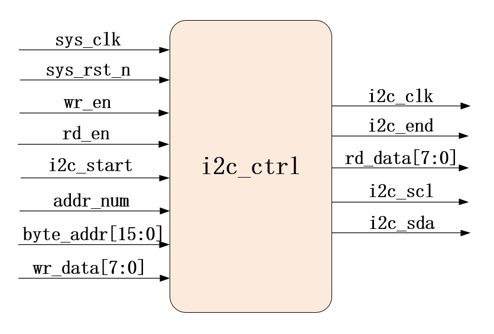
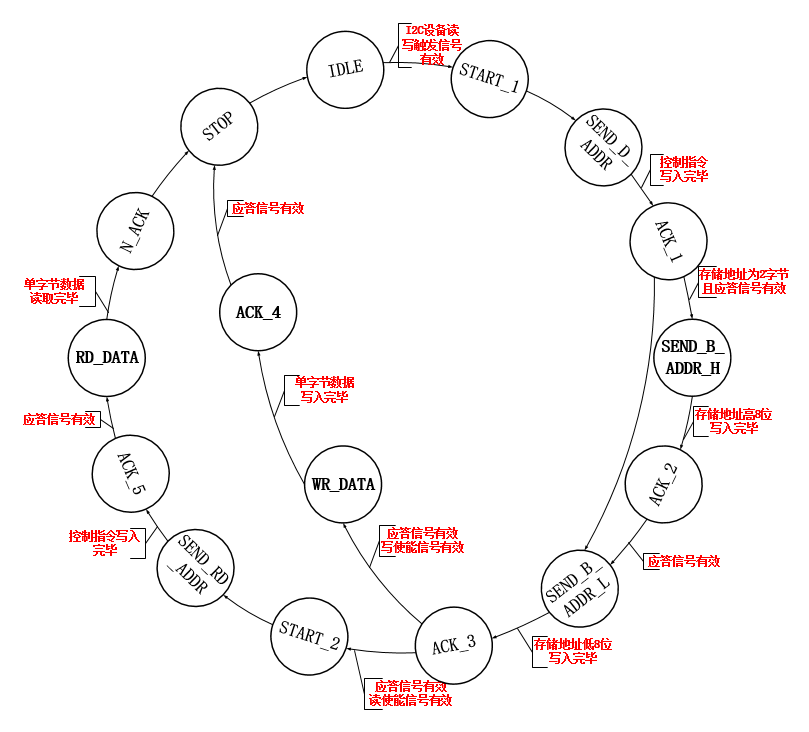
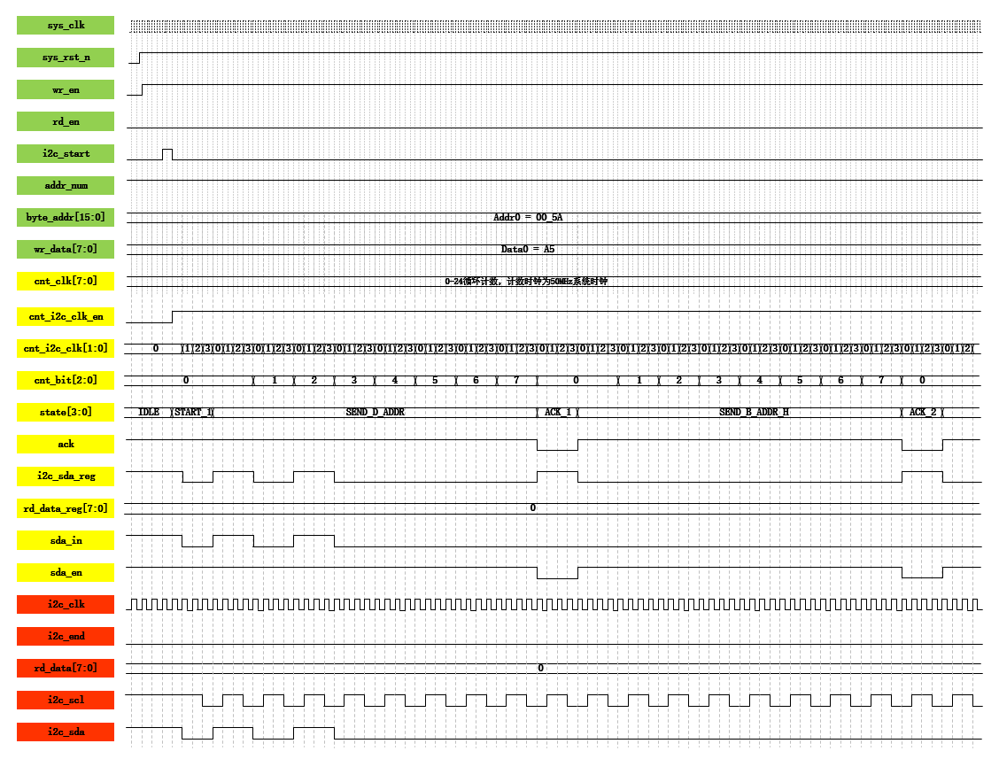
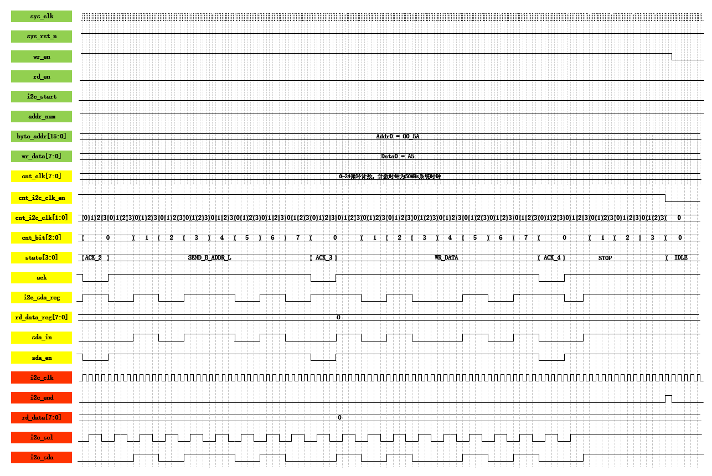

### 整体工程

主要讲解i2c_ctrl的设计，该模块输出信号`i2c_scl`和`i2c_sda`直接与EEPROM相连接。

- 输入信号：
	- 时钟复位、读写使能必备；
	- 单字节数据读写开始信号`i2c_start`；
	- I2C读写操作存在单双存储地址，`addr_num`作为标识信号，0单字节1双字节；
	- `byte_addr`为存储地址，`addr_num`输出0则说明存储地址为单字节，则只写入低8bit；输入1则写入全部16bit；
	- `wr_data`为待写入数据；
- 输出信号
	- `i2c_clk`是本模块的工作时钟，频率为1MHz；
		- 为什么要生成这一时钟？
			1. EEPROM读写操作的串行时钟`scl`频率为250KHz，读写操作为低电平，其他时候为高电平，如果用50MHz系统时钟生成较为麻烦，故先分频为1MHz时钟，再在次基础上生成`scl`；
			2. 给i2c数据数据收发模块使用作为其工作时钟；
	- `i2c_scl`、`i2c_sda`分别是串行时钟信号和串行数据信号，由模块产生传入EEPROM；
	- `i2c_end`信号输出给数据收发模块(i2c_rw_data)，表示一次单字节数据读写操作完成。
	- `rd_data`信号表示自EEPROM读出的单字节单字节数据。

### 实现方法

使用状态机可以方便实现IIC协议4个部分的整体跳转。

- 状态机跳转：
	1. 系统上电后，状态机为初始状态**IDLE**，接受到`i2c_start`单字节数据读写开始信号后跳转到下一个状态**START_1**；
	2. FPGA向EEPROM存储芯片发送起始信号START（1bit低电平）；
	3. 随后跳转到状态**SEND_D_ADDR**发送地址状态，此状态向EEPROM存储芯片写入控制指令 —— 地址 + 写"0"，此时等待从机回传应答信号；
	4. 从机应答后，根据`addr_num`标识位看存储地址是单字节还是2字节；
		- `addr_num`为1则跳到SEND_B_ADDR_H，先发送高8bit，等待应答信号，从机应答后跳到SEND_B_ADDR_L；
		- `addr_num`为1则直接跳到SEND_B_ADDR_L，发送低8bit，等待应答信号；
	5. 从机应答后根据读写使能判断此时的操作：
		- 写使能有效：跳转到状态WR_DATA，主机发送写数据后等待应答，从机应答后跳到STOP状态，主机发送1bit"0"而后拉高；
		- 读使能有效：
			- 跳转到状态START_2，需要主机再次发送起始信号（1bit低电平）；
			- 而后跳转到状态SEND_RE_ADDR，发送控制指令 —— 地址 + 读"1"；
			- 跳转到ACK_5等待从机应答；
			- 从机应道跳转到RD_DATA，从机返回读数据；
			- 数据接收完成，跳转到N_ACK，**主机产生一个时钟`无应答信号`**;
			- 最终跳到STOP状态，主机发送1bit"0"而后拉高；

### 波形图

#### 单字节写波形

单字节写操作局部波形图（一）

单字节写操作局部波形图（二）

波形：首先通过cnt_clk产生1MHz时钟i2c_clk，后续信号由此为基准；i2c_start拉高，状态开始跳转，cnt_i2c_clk_en拉高；当检测到该信号拉高，计数器cnt_i2c_clk、cnt_bita开始计数，开始数据读写操作，下一个时钟沿到来时i2c_sda拉低（**FPGA向EEPROM存储芯片发送起始信号**）；当cnt_i2c_clk计数到3，此时状态跳转，i2c_sda跳转；
对于scl时钟信号（**组合逻辑赋值**）：IDLE拉高；START_1时cnt_i2c_clk为3时赋值0其他时候都为1；除了前两个状态和STOP状态，cnt_i2c_clk每当计数到1和2时，拉低，3和0时拉高；STOP状态下，(cnt_bit == 3'd0) &&(cnt_i2c_clk == 2'd0)时拉低，其余时刻拉高。
i2c_sda每个bit位持续一个i2c_scl周期的时间，但是bit持续时间的中间两个cnt_i2c_clk，i2c_scl为高电平（**数据保持**）；而bit持续时间的左右两个cnt_i2c_clk，i2c_scl为低电平（**数据更新**）。
【注】
1. SDA拉低，则表示开始传输，发送起始信号；但是，结束时SDA后SCL两个cnt_i2c_clk计数拉高；
2. SCL拉低SDA数据更新，SCL拉高SDA数据保持；SCL**2**SDA**4**。