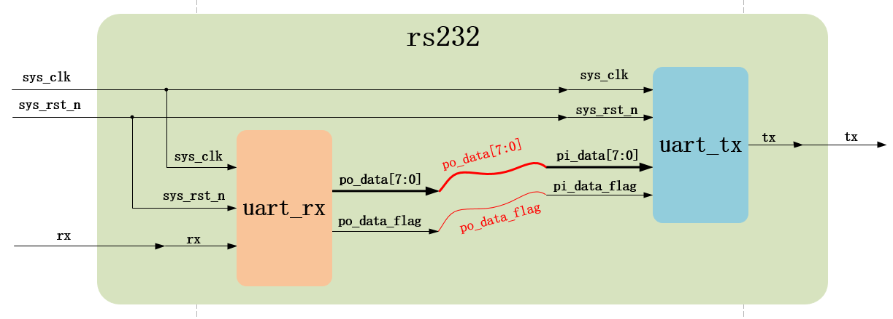
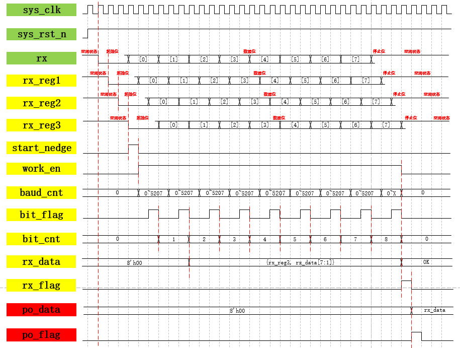
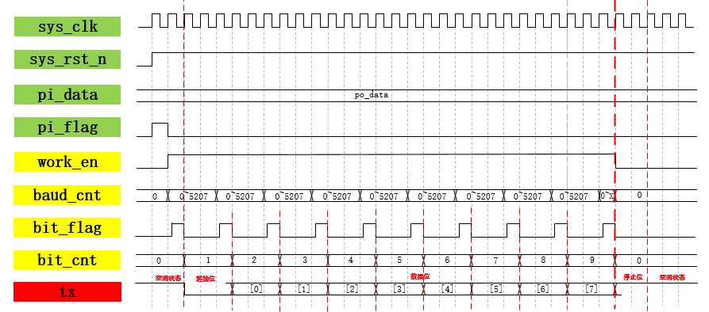

### 前置说明

串口发送，一个波特传输1bit数据，故需要一个计数器进行计数，计数具体数值计算：cnt = 1s ÷ (baud:9600) ÷ (一个时钟周期:20ns) ≈ 5208

### 整体工程

- rx模块：将输入的串行信号转换成并行发送给tx模块；同理，tx模块将并行转串行发出；
- `po_data_flag`标志信号用以说明并行数据稳定有效，可被后级模块使用。
### RX模块

- 波形说明：
	- 中间信号：
		1. rx模块三级打拍：前两级消除亚稳态，`rx_reg1`仍有可能不稳定，不用1和2信号产生`start_nedge`标志位，故再打一拍；
		2. `start_nedge`仅作标志信号（产生1拍），作用是将使能信号`work_en`的拉高条件，不直接使用其做条件因为后续数据位出现1到0的变换还会产生新的`start_nedge`；
		3. `work_en`拉低条件为：bit位计数器计数到8且bit_flag信号拉高；
		4. `bit_flag`作为取数标志信号，在波特计数器计数到中间值即2603时。拉高一个时钟，此时数据已经稳定，**勿取边沿值**；
		5. 增加输入信号bit位计数器，用以和`bit_flag`作为移位完成标志位条件，注意bit计数器复位条件为`if((baud_cnt == BAUD_CNT_MAX - 1) || (work_en == 1'b0)`；
		6. 以上所有信号都是为了将8个1bit信号通过移位拼接为一个8bit信号并输出；
		7. `rx_data`当bit位计数器计数到1~8且bit_flag信号拉高，将此时`rx_reg3`依次向前插入到8bit数据包中：`rx_data <= {rx_reg3, rx_data[7:1]};`
		8. `rx_flag`在bit位计数器计数到8且bit_flag信号拉高时拉高一个时钟周期；
	- 输出信号：
		1. `po_data`是`rx_data`信号延后一个时钟周期，时序逻辑幅值`po_data <= rx_data`；
		2. `po_flag``rx_flag`信号延后一个时钟周期，条件为`rx_flag == 1'b1`；

### TX模块

- 波形说明：
	- 中间信号：
		1. `work_en`拉高条件为`pi_flag`拉高，拉低条件为bit位计数器计数到9且`bit_flag`信号拉高;
		2. `buad_cnt`和`bit_flag`设计同上，`bit_flag`只要不在0或5207拉高，其余位置皆可；
		3. tx模块的`bit_cnt`区别于rx模块的是，需要计数到9用来传出停止位，接收可不接；
	- 输出信号：
		1. tx幅值用case语句，在`bit_flag`为1的条件下，根据`bit_cnt`依次幅值：起始位、数据位1~8、停止位。

其他说明：
1. 宏定义：`parameter UART_BPS = 'd9600, CLK_FREQ = 'd50_000_000`
2. 波特率计数器最大值：`localparam BAUD_CNT_MAX = CLK_FREQ/UART_BPS ;`
3. 看懂波形和中间变量、输出变量幅值条件易得code。