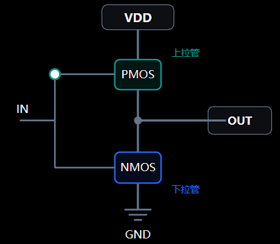
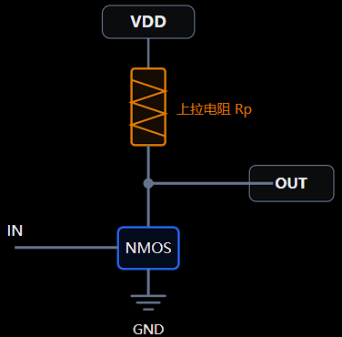

## 笔试汇总

1. 三极管与MOS管的差异
	- 三极管是流控型器件，输入阻抗低；MOS管是压控型器件，输入阻抗高；
	- 三极管工作状态分为：放大区、饱和区、截止区；MOS管：截止、可变电阻、恒流；
	- MOS管开关速度快，功耗小；
2. LDO与DCDC的区别：
	-  LDO：线性降压，通过分压实现，且只降压，电路简单纹波小，但发热大效率低，只适合小功率压降不是很大的电路。
	- DCDC：开关电源，通过快速开关和储能的原理实现升降压，效率高、发热小，适合大电流、较大功率场景，但电路复杂，纹波噪声大。
3. 三极管共射、共基、共集电路：
	- 共射：放大`I`和`V`的作用，输入电阻居中，输出电阻较大，频带窄，用于一般放大；
	- 共集：只放大`I`，输入电阻大，输出电阻小，具有**电压跟随**的特点，用于多级放大输入/出级；
	- 共基：只放大`V`，输入电阻小，输出电阻与电压放大倍数与共射相当，高频特性好，用于宽频带放大。
4. 排除电路板**短路**的故障：
	- 目测器件是否烧糊，闻是否产生烧糊味；
	- 万用表测各个电源对地阻抗；
	- 分段拆卸器件进行测量阻抗，逐步定位；
	- 小电流给板子供电，用热成像仪查看发热器件。
5. I2C通信：
	- 信号线：SDA、SCL；都是开漏输出接上拉电阻（原因1：开漏接上拉电阻表示高电平；2：实现“线与”的功能）
	- **半双工同步**通信、工作模式分主从，同一时刻只有一个主设备，从设备通过地址选择。
6. 推挽输出与开漏输出：
	- 推挽输出：能主动输出高电平和低电平；
		- 优点：1、高低电平都由MOS管主动驱动；2、输出阻抗交底，驱动能力较强；3、上升沿和下降沿通常较快；4、一般无需外接上拉电阻。
		- 缺点：两个推挽输出不能随意直接连接在一起。
		- 应用：SPI、UART RX、GPIO
		- 代码：`assign data_out = data_in;`
	- 开漏输出：只能主动拉低电平，不能主动拉高电平；通常要外接上拉电阻输出高电平；
		- 优点：支持线与连接
		- 应用：I2C、共享中断、复位
		- 代码：`assign sda = drive_low ? 1'b0 : 1'bz;(区别于三态门：无高电平)
	- 为什么I2C使用开漏而SPI用推挽？
		- I²C 需要多设备共享信号线、实现线与、仲裁和时钟拉伸；SPI通常由明确的驱动端控制各信号线，采用推挽可以实现更快的信号边沿。SPI的MISO等共享线通常还需要三态控制。
	- 三态输出与开漏输出区别：三态可以处于高、低电平、高阻态三种状态，而开漏无法输出高电平状态；开漏输出不能**主动驱动高电平**，但释放总线后，可以通过外部上拉电阻形成高电平。
7. I²C如何实现多主机仲裁
	- 线与操作：主动发送1的主机将失去仲裁，释放SDA；发送0的主机将得到仲裁，且视为主动拉低SDA，将进行后续操作。
	- 例如：主机A发送地址1011；主机B发送地址1010；主机各自发送第4bit时，由于线与逻辑，任一主机输出0，SDA电平为0，且发送0的主机占用SDA、发送1的主机失去仲裁！
	- I²C仲裁中，0是显性电平，1是隐形电平。
8. SPI？特点？
	- 信号线：SCK、MOSI、MISO、CS；
	- 通信方式：**全双工同步**通信、通信速度快；一主多从；四种工作模式。
9. UART？特点？
	- 信号线：RX、TX；
	- 通信方式：**全双工异步**通信，通信双方需要约定波特率，波特率为9600/115200。
10. CAN？特点？
	- 信号线：CAN_N、CAN_L；
	- 通信方式：**半双工异步**串行通信，且是差分信号，抗干扰性强，常用于车载，一般需要接终端电阻（120R），CAN通信具有总线仲裁机制，且ID小的主机赢得仲裁。
11. 物理接口、电气标准与通信协议：
	- 看得见的接口：RS232、RS485、UART引脚；
	- 电器标准：LVDS、RS232、TTL等；定义了电压具体多少为高电平，多少为低电平；
	- 通信协议：数据的格式、时序、规则；UART起始位、数据位、停止位；
12. DMA？特点？
	- 直接存储器访问，让外设/模块直接和内存读写数，无需CPU全程参与搬运；
	- 具有高效性，提高系统效率；灵活性，可配置多张模式，单次传输、循环传输等。并行性，可以和CPU同时操作，减少数据传输延迟。
13. RS485、RS232、RS422
	- RS485：
		- 两根差分线A、B，抗干扰能力强、传输距离远，近距离传输一般需要加120R（并联）终端电阻。
		- **半双工异步**通信，支持多节点通信，跑Modbus协议，高电平压差+2~+6；低电平为-2~-6；-2~+2为不稳定状态，尽量避免。
	- RS232：
		- TX、RX两条线单端信号，抗干扰能力较弱，通信速度较慢，只做短距离传输；
		- **全双工异步**通信，只能一对一通信，一般用于串口调试，逻辑电平为负逻辑，高电平为-3~-15，低电平为+3~+15；
	- RS422：
		- 两对差分线：TXD+、RXD+、TXD-、RXD+，抗干扰能力最强，通信速度最快；
		- **全双工异步通信**，只能点对点通信，逻辑电平和485一样，适用高速信号，10Mbps。
14. MOS管和三极管选型时需要关注哪些参数？
	- MOS管：
		- 根据工作电压电流选择Vds（漏源电压）与Id（漏极电流）；
		- `Rds(on)`导通电阻：电阻大小直接影响到功耗、散热；
		- `Vgs(th)`导通压降：开启电压需要> `Vgs(th)`；导通压降太大，Rds也会很大；
		- 寄生电容，影响开关速度；
		- 此外需要注意封装，MOS管的引脚序号。
	- 三极管：
		- 根据工作的电压电流选择VCEO（集射击穿电压），IC集电极最大电流，功耗PC，确保匹配电路的实际功耗，以及hfe电流放大倍数；
		- 根据空间散热选择封装。
15. 电源纹波如何测试，主要观察哪些参数？
	- 示波器测试：
		- AC耦合（纹波未交流信号，需要隔直流）
		- 带宽20MHz（电源纹波在10MHz左右，防止高频噪声干扰）
		- 垂直挡位调制较小（5mV/格）
		- 横线时基适当调大（10us/格）
	- 主要参数：峰峰值
16. 运放的特点与选型主要需要考虑哪些参数？
	- 运放具有**高增益**、 **高输入阻抗**和**低输出阻抗**并且能够通过反馈实现精准放大。
	- 应用场景：
		- 直流精度：关注输入失调电压Vos、输入偏置电流IB；
		- 频率特性：注意增益带宽积GBW、压摆率SR；
		- 抗干扰性：共模抑制比（CMRR）、电源抑制比（PSRR）。
17. 二极管：
	- 硅管：死区电压0.5V，导通压降0.7V；
	- 锗管：死区电压0.1V，导通压降0.3V。