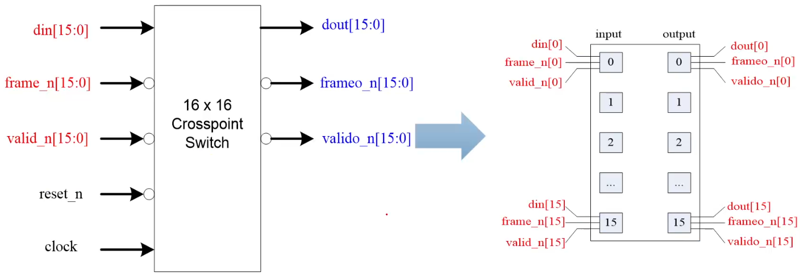

### 管脚图

router：路由器



16路输入对应16路输出，共三组信号：data、frame和valid。

### 设计说明

√ 时钟上升沿触发和采样
√ 输入输出均为串行，即1bit/1clk
√ packet包括header和payload
√ packet可以通过任一输入端口输入并从对应输出端口输出
√ 输入输出间没有内部延迟

### 输入packet时序和信号说明

√ `frame_n`：
	下降沿指示packet的第一位数据
	上升沿指示packet的最后一位数据
√ `din`：
	输入数据，即packet
√ `valid_n`：
	`valid_n`为低时`payload`数据有效


`dest.address`：目的地地址；（可能是设计说明中packet包括的另一个元素header）
`pad`：填充物，非有效数据；
`payload`：有效数据。
> 输入数据在`frame_n`和`valid_n`同时为低的时候有效，除最后一位数据`frame_n`为高。
> 验证时常验证异常情况，以此为例：`frame_n`和`valid_n`只有一个信号为低的情况是否有效？

### 输出packet时序和信号说明

√ 输出数据端口为`frameo_n`、`valido_n`、`dout`
√ 当`valido_n`和`frameo_n`均为低时数据有效，除了packet最后一位输出数据时`frameo_n`为高


### 复位时序说明

√ `reset_n`低电平复位，复位时`frame_n`和`valid_n`为高电平
√ 有效复位至少保持一个`clk`
√ 复位后至少等待15个时钟周期后才能开始发送数据


### 项目文件更改

更改Makefile前后

``` bash
compile:
	vcs -full64 -top router_test_top -l vcs.log -sverilog -timescale=1ns/100ps -debug_access+all -ntb_opts uvm $(SVTB) $(RTL)
	# vcs -full64 -l vcs.log -sveirlog -debug_all $(SVTB) $(RTL)
# 添加verdi
verdi:
	verdi -ntb_opts uvm -top router_test_top -sverilog -full64 +incdir+../../ $(RTL) $(SVTB) -ssf sim.fsdb &
```

顶层加入代码 `import uvm_pkg::*`和``include "uvm_macros.svh"`
测试代码文件加入
``` systemverilog
initial begin
	$fsdbDumpfile("sim.fsdb");
	$fsdbDumpvars(0, router_test_tb, "+all");
end
```

将sa和da的直接幅值改为`$urandom(15, 0);`

通过观察波形：`frame_n`为低时`valid_n`为高时发送地址，后面经过一段pad，直到二者同时为高时发送数据