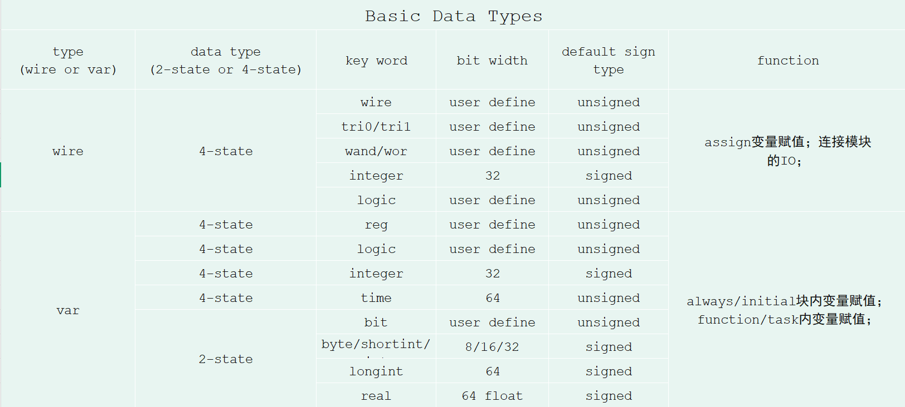

## SV基本数据类型

### 总览图



```
//type  data_type   signal_name
//net or var    2 or 4 state
var logic a;
wire logic b;
```

- 通常可以不定义type，工具自动根据后续变量使用的赋值自动推断成相应的type；
- wire type必须是4-state，可以多驱动；var type只能单驱动；
- sv新增加logic类型可以说正是为了替换verilog中的wire和reg类型，logic既可以是wire也可以是var；
- 为了节省程序内存，sv新增多种2-state类型；
- **口诀**：4值只有integer有符号，2值只有bit无符号。

### 类型转换

- 静态类型转换，在编译时进行，不会改变程序的运行时行为；

>类型转换：`data_type'(var) `
>数据位宽转换：`bit_size'(var)`
>符号类型转换：`signed'(var)`，`unsigned'(var)`

- 动态类型转换，在运行时进行，会改变程序的运行时行为；`$cast(des_var,source_var);`
- 类型转换可以使用`cast`操作符，也可以使用`cast`函数；

### 数组类型

- 静态数组（定宽数组）：数组大小在编译时确定，不可动态改变。`bit[3:0][7:0] barry[3];`
	- 合并数组packed：定义在变量前
	- 非合并数组unpacked：定义在变量后
	- 访问合并与非合并混合：定义`bit [3:0][7:0]a[3];`，则`a[0][1][6]`表示深度为0即第一个32bit数组，4个字节的第2个字节的，第7个bit。

| 特性     | 合并数组（packed array） | 非合并数组（unpacked array） |
| ------ | ------------------ | --------------------- |
| 内存布局   | **连续存储**，紧密排列      | 非连续存储，独立存放            |
| 维度声明位置 | 变量名左侧`[3:0][7:0]a` | 变量名右侧`a[0:3][0:7]`    |
| 位选择和切片 | 支持直接位选择            | 不支持位选择，只能访问完整元素       |
| 仿真效率   | 内存占用小，访问快          | 占用大，访问慢               |
| 典型用途   | 硬件寄存器，总线，          | 复杂数据结构，独立元素处理         |

- 动态数组：数组大小在运行时动态分配，使用`new[]`分配内存。
- 关联数组：通过任意数据类型作为索引（如int，string），**索引无需连续，稀疏数据存储**。 `int swtich[string]`
- 队列：支持动态增删元素，使用`$`符号声明，支持高效的前后插入和删除操作。
