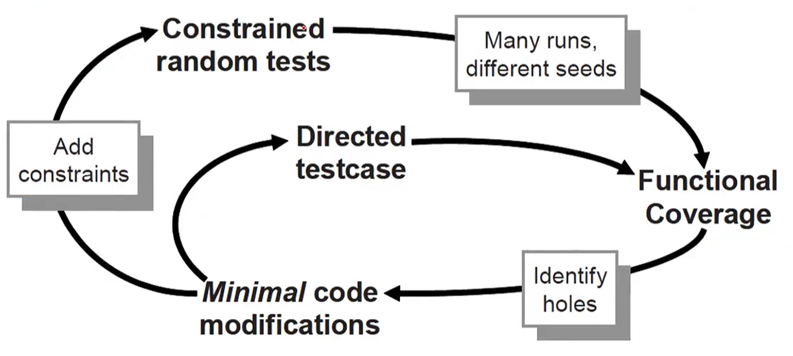
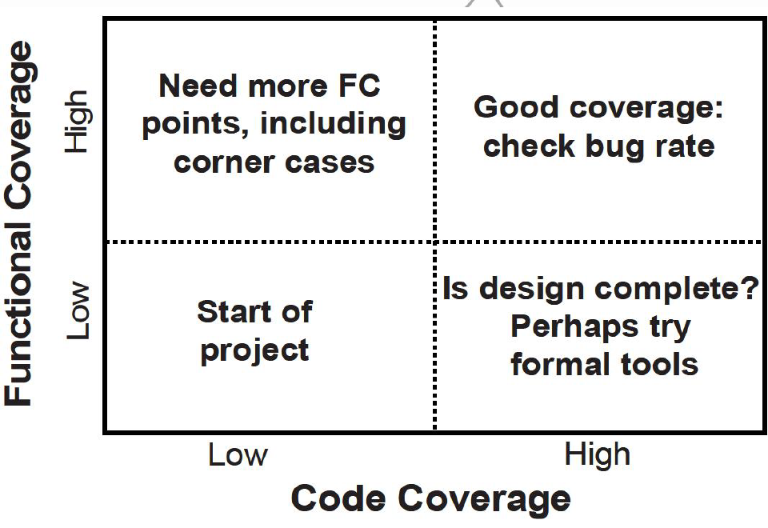

### 概览

- 覆盖率反馈环路
- 代码覆盖率：RTL（DUT），设计人员编写，VCS自动生成
- 功能覆盖率：验证人员编写，根据DUT功能来编写
- 断言覆盖率：同上
- 漏洞率：有哪些bug
- 知道如何进行覆盖率分析

覆盖率是用来衡量设计验证完备性的；逐步覆盖各种合理组合，覆盖率用来测量测试进行程度。
覆盖率工具在仿真时收集信息，然后后续处理得到覆盖率报告。
通过blog找到盲区

IP级验证->子系统级验证->SoC级验证

### 覆盖率反馈回路



两条回路
1. 定向测试用例 -> 功能覆盖率 -> 识别漏洞 -> 最小代码修改 -> 定向测试用例 ……
2. 添加约束条件 -> 约束随机测试 -> 多次运行不同种子 -> 功能覆盖率 -> 识别漏洞 -> 最小代码修改 -> 添加约束条件 ……

### 代码覆盖率

1. line/branch/condition coverage //每一行覆盖率；分支覆盖率；条件覆盖率
2. paths coverage //所有路径是否cover
3. toggle coverage //所有变量都有过0，1翻转，即0 ->1 ; 1->0
4. FSM coverage    //状态自身；状态跳转

- 代码覆盖率结果，就是检测对设计代码运行程度的衡量。（不收集TB的覆盖率）
- 未经测试的设计代码：硬件漏洞、冗余代码、条件难以达到；
- 代码覆盖率衡量的是测试对硬件设计描述的*实现究竟测试得多彻底*，而非针对验证计划；代码覆盖率是验证工作的必要条件而不是说明工作完成。

### 功能覆盖率

- 目的：确保设计在实际环境中得行为正确。
- spec说明设计如何运行，验证计划列出相应功能如何激励、验证和测量。
- 某功能在设计中被遗漏，代码覆盖率无法发现错误，但是功能覆盖率可以。

### 断言覆盖率（立即断言/并行断言）

- 断言：用于 一次性地 或在 一段时间内 核对 两个设计信号 之间关系 的声明性代码。
- 代码覆盖率不关心触发多少次，但是断言覆盖率可以测量断言触发的次数。
- 可用SV的程序性代码编写等效性检查，但用SVA[^1]（SV断言）表达更容易。
- 断言用于**查找错误**。
- 一旦检测到问题，仿真可以立即停止；（自行编写n个error仿真停止，1个fatal立即停止）。
-  断言可以用于查找感兴趣的信号的值或状态。（用`cover property`[^2]测量这些信号）

### 漏洞率

- 大型项目中，保持**追踪**每周多少漏洞被发现。
- 开始时，观察即可观察某些漏洞 -> 某个case跑fail了；
- 设计稳定，利用自动化的检查方式协助发现可能的漏洞；
- 设计临近流片，漏洞率下降设置为0，让需要验证工作；
- 每次漏洞率下降，就应该找不同方法测试可能的边界情况（corner case）；
- 漏洞率若呈现上升趋势，设计大概率有问题。


## SV覆盖策略及覆盖组

### 概览

- 覆盖策略
- 验证的完备性
- 定义和使用covergroup
- 在类里定义covergroup
- covergroup的采样触发
- 使用事件触发

#### 覆盖策略

> ① 收集信息而非数据，以fifo为例，不关系fifo被哪些数据写满，只关系写满读空这个信息。
> ② 开始不关心功能覆盖率，只关心功能是否实现，功能覆盖率卡销很大，降低仿真性能。
> ③ 需要设定合理的覆盖率采样的事件，提升采样效率，且也可以降低收集覆盖率的开销。

#### 验证的完备性

1. 完备的覆盖率测量结果和漏洞增长曲线，可以帮助确认设计是否被完整地验证过。
2. 如果功能覆盖率高但代码覆盖率低，这说明验证计划不完整，测试没有执行设计的所有代码。
3. 如果代码覆盖率高但功能覆盖率低，这说明即使测试平台很好地执行了设计的所有代码，但是测试还是没有把设计定位到所有感兴趣的状态上。



#### 覆盖组covergroup

- 概述
	- 与类相似，一次定义可多次实例化。
	- 包含一个或多个coverpoint，且全在同一时间采集。
	- 可定义在类中，也可在interface或module中。
	- 可以采样任何可见的变量，例如程序变量、接口信号或设计端口。
	- 一个class可以多个covergroup（可根据需要自行enable或disable）。
	- 每个covergroup可以定义单独的触发采样事件，允许从多个源头收集数据。
	- covergroup必须被例化才可以用来收集数据。

`看DUT内部信号，用assign将内部信号取出到类或者module、interface中。`

##### 定义和使用covergroup

```systemverilog
class Transaction;
	rand bit [31:0] data;
	rand bit [ 2:0] port; // Eight port numbers
endclass
program automatic test(busifc.TB ifc);
covergroup CovPort;
	coverpoint ifc.port; // Measure coverage，固定写法
endgroup
initial begin
	Transaction tr;
	CovPort ck; // 在program中需要和class一样需要句柄
	ck = new(); // Instantiate group
	tr = new();
	repeat (32) begin // Run a few cycles
	assert(tr.randomize); // Create a transaction
		ifc.port <= tr.port; // and transmit
		ifc.data <= tr.data; // onto interface
		ck.sample(); // Gather coverage
		@ifc.clk; // Wait a cycle
	end
end
endprogram
```

##### 在类中定义covergroup

```systemverilog
class Transaction;
	logic [31:0] data;
	logic [ 2:0] port;
endclass

class Transactor;
	Transaction tr;
	mailbox mbx_in;
	virtual busifc ifc;
	covergroup CovPort;
		coverpoint tr.port;
	endgroup
	function new(mailbox mbx_in, virtual busifc ifc);
		CovPort = new();
		this.mbx_in = mbx_in;
		this.ifc = ifc;
	endfunction
	task main;
	begin
		mbx_in.get(tr);
		ifc.port <= tr.port;
		ifc.data <= tr.data;
		CovPort.sample();
	end
endtask
endclass

program automatic test(busifc ifc);
	initial begin
		Transaction tr;
		mailbox mbx_in;
		Transactor tr_c;
		tr = new();
		mbx_in = new();
		tr_c = new(mbx_in,ifc);
	repeat (32) begin // Run a few cycles
		assert(tr.randomize); // Create a transaction
		mbx_in.put(tr);
		tr_c.main(); // send driver and gather coverage
		@ifc.clk; // Wait a cycle
		end
	end
endprogram

//在program中可以使用class中定义好的covergroup
```

#### covergroup的采样触发

- covergroup由采样的数据和数据被采样的事件构成。当两个条件准备好后，便会触发covergroup。
- 这个过程可以通过直接使用sample()函数完成，也可以在covergroup中采样阻塞表达式或者使用wait或@实现在信号或事件上的阻塞。
- 如果想在代码中显式地触发covergroup采样，或者不存在采样时刻的信号或事件，又或者一个covergroup被例化为多个实例需要单独触发，那么可以使用sample()方法。
-  如果想借助已有的事件或者信号触发covergroup，可以在covergroup声明中使用阻塞语句。

<[systemverilog中covergroup的用法 - SOC验证工程师 - 博客园](https://www.cnblogs.com/Alfred-HOO/articles/19550541)>


---
[^1]: SVA是在SV中编写的一种语言，表达等效性检查更容易

[^2]: 另外还有Assert/Assume等property
