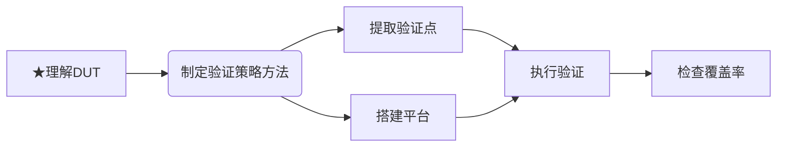
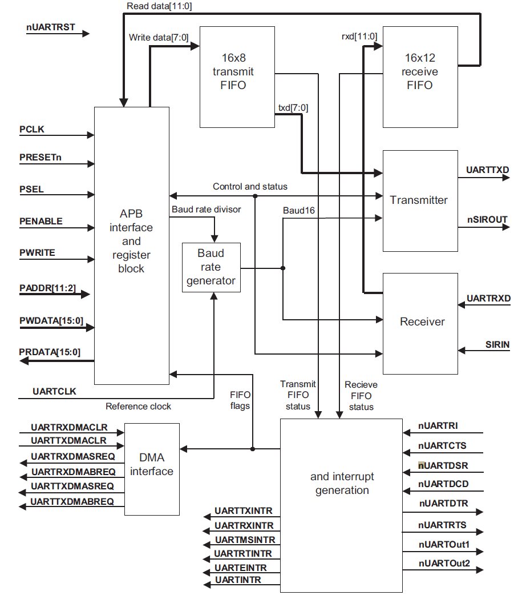
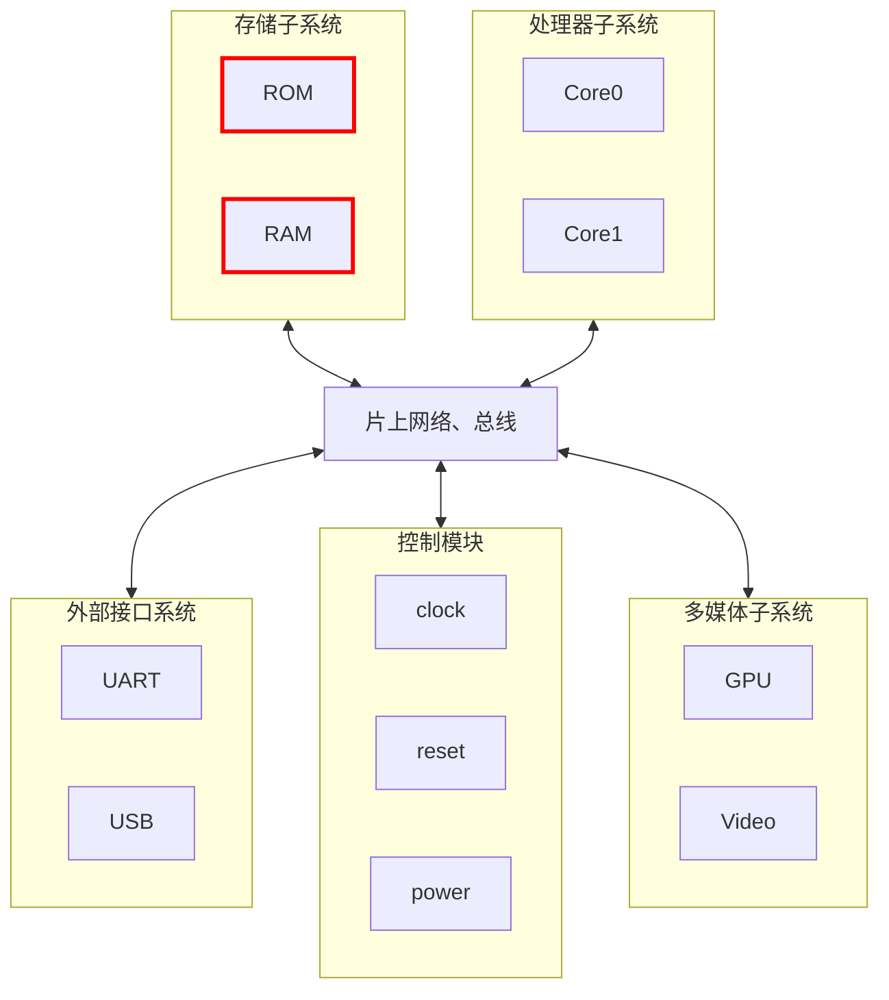
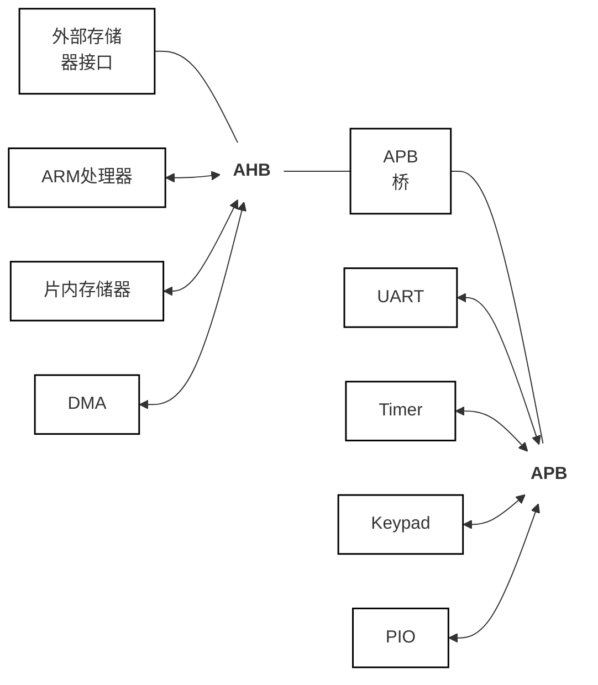

## 理解DUT

### 定义

- DUT(Design under Test)：待测设计，一般关注设计实体本身，时间属性为**静态描述**。
- DUV(Design under Verification)：被验证设计，是一个‌**动态概念**‌，侧重于强调验证过程和方法。
- 目前的芯片按功能划分四种类型：内存芯片、微处理器、标准芯片和复杂片上系统（Soc）
- 按集成电路类型划分三类：数字芯片、模拟芯片、数模混合芯片
- 该流程输出feature point
### 验证整体流程示意图




- 当给到一个IP（uart、SPI、I2C、USB、DDR、UFS），首先我们需要读对应IP的SPEC，SPEC中都会存在微架构整体框图，例如：CSR、FIFO、APB、ITR等各个模块的连接与功能描述，以及寄存器配置，给出对应实例。

### 下面以uart的SPEC为例：

1. 提取验证点：从SPEC中的`1.1.1 Features`、`Programmer‘s Model`-`3.3 Register descriptions`中列出验证点。
2. 下面是UART_SPEC中所展示的整体微架构框图，在框图下方会给出各个模块信号的说明与功能描述，需要在制定验证策略时详细阅读。

3. 理解DUT时，通过SPEC的feature list中mode、register、Arch即可读取简略验证点
4. 提取好验证点，需要制定验证策略和方法，画出验证结构图搭建验证平台
5. 后续进行验证的执行，跑第一个验证测试（smoke测试）
	- smoke测试
		- 先编译，使能后配置可读可写寄存器，读写数据一致即验证通过
		- 检查RTL语法和TB语法错误
6. 接着写正常的case一一验证，后续进行覆盖率、断言检查

### SoC

- SoC即系统级芯片又称片上系统（System on chip）
- SoC将系统的主要功能综合到一块芯片中，本质上是在做一种复杂的IC设计。SoC是集成电路设计和制造工艺发展的产物，它可以将整个系统集成在一个芯片上。
- 下面展示的是SoC系统架构图


#### SoC-总线

常见总线：AMBA（Advanced Microcontroller Bus Architecture）总线（ARM）—— 包含AHB、APB、AXI、ASB，CoreConnect总线（IBM），Wishbone总线（Open Cores），NOC


- AHB总线用于连接CPU、存储器、DMA；APB连接外设UART、Keypad、Timer、PIO等；二至直接通过APB桥连接。
- AHB:(Advanced Hign-performance Bus)
	- 针对高效率高频宽及快速系统模块所设计的总线；
	- 它可以连接如微处理器、内存模块和DMA等高效率模块
- APB:(Advanced Peripheral Bus)
	- AMBA中的低速总线
	- 用在低速且低功耗的外围
	- APB在AHB和低带宽的外围设备之间提供了通信的桥梁
- AXI:(Advanced eXtensible Interface)
	- AMBA3.0协议中最重要的部分，是一种面向高性能、高带宽、低延迟的片内总线。

#### SoC-Mem

- ROM(只读存储器)是一种只读存储器，包括掩膜式ROM、可编程ROM(PROM)、可擦除的可编程ROM(EPROM)和电可擦除的可编程ROM(EEPROM)等。ROM在SoC中一般用来存储固定的代码或资料。
- SRAM(静态随机存储器)，只要保持通电，里面储存的数据就可以保持。它的特点是存储速度非常快，可以达到和处理器的时钟同步，在系统中常常作为处理器的缓存。存储空间的RAM的面积较大，在SoC中只能少量使用
- EMMC (Embeded MultiMedia Card)：针对手机或平板电脑等产品的内嵌式存储器。
- Flash:进行可快速存储、擦除数据的存储物质，例如固态硬盘
- OTP(One Time Programmable)是单片机的一种存储器类型，意思是一次性可编程；程序烧入单片机后，将不可再次更改和清除

#### SoC-外设接口

- GPIO（通用输入输出，可编程IO口，能够进行复用） UART SPI
- USB PCIE
- `clk`、`reset`、`power(optinal)`、bus（寄存器访问/数据传输）、interface(PAD)、others

#### SOC软硬件接口
- 存储空间映射(Memory Map)，包括所有设备的可配置寄存器的地址映射
	- SoC中的各个片上模块及与之通信的片外设备，均采用统一地址空间进行编址访问，为每一个设备分配一定数量的地址空间
- 中断服务程序及中断向量
	- 当处理器正在处理内部数据时，外界发生了紧急情况，要求处理器暂停当前的工作转去处理这个紧急事件。处理完毕后，再回到原来被中断的地址，继续原来的工作，这样的过程称为中断。
	- 对于紧急事件的处理程序称为中断服务程序
	- 各类中断服务程序的入口地址均存放在中断向量表中
- 其它

## 验证策略

- 两个维度
	- 广度（按照层次）
	- 深度（按照透明度）
		- Black-Box approach（黑盒验证）
			- 不关心被测设计的内部信号，从注入激励和结果来比较。
			- 优缺点：优点：操作简单，易于维护；缺点：出错后难以定位，要从两端推导。
		- Grey-Box approach（灰盒验证）
			- 白盒和黑盒结合的环境。
		- White-Box approach（白盒验证）
			- 了解设计的内部逻辑、层次、信号等。
			- 优点是迅速定位问题。
			- 缺点是专注于设计内部逻辑而忽略整体功能的测试。
			- 验证维护成本高。
- 按层次划分
	- module/unit level verification 
		- 注重模块功能正确性
		- 一般是白盒验证
	- sub-system level verification  可能是灰盒和黑盒验证
	- chip/system level verification 可能是灰盒和黑盒验证
	

## 验证方法

- Dynamic Simulation动态验证
	- Directed Test 定向测试
	- Random Test随机测试
	- 基于事务级的验证
	- 基于Coverage的验证
	- Assertion check断言检查
- Static check静态检查
	- Linting语义检查
	- Cross Domain Check跨时钟与检查
	- Formal Check形式验证
		- Equivalence Check等价检查
		- Property Check属性检查F
- hardware acceleration硬件加速
	- FPGA验证
	- emulator专用模拟器

### 动态仿真(Simulation-based Verification）需要仿真器

业界主要的仿真器有
- Cadence: NCSIM
- Synopsys: VCS
- Mentor: Modelsim / Qusta

设计验证语言：VHDL/Verilog/System Verilog/C/System C

动态仿真通过测试序列/激励生成器给DUT适当的激励，随着仿真进程的推进，判断输出是否符合预期。
- 按照激励的颗粒度有：基于事物级的验证
- 按照激励的生成方式有：直接测试和随机测试
- 按照检查结果和方式有：基于Coverage的验证和断言检查

### 基于事物级的验证

- TLM（Trasaction-level model）
- BFM：BFM是将高抽象级的TLM命令转换为低抽象级的硬件接口时序
基于信号级验证框图：

基于事务级验证框图：


|特性|基于信号级 (右上)|基于事物级/TLM (下方)|
|:--|:--|:--|
|抽象层级|低 (Low-level)|高 (High-level)|
|输入/输出形式|二进制比特流 (0和1)|事务/命令 (如 do read, do write)|
|是否需要 BFM|不需要，直接对接引脚|必须需要，BFM负责高低层级的转换|
|开发效率|低，编写测试用例困难|高，几行代码就能描述复杂的总线操作|
|仿真速度|慢 (因为要模拟每个时钟周期)|快 (忽略了不必要的时钟细节，关注数据交互)
### 定向测试

- 定义：定向测试是指激励内容在仿真之前已经决定下来，测试用例给出的激励序列不会在下一次提交任务时改变。
- 举例：
``` systemverilog
// addr data
bus write(0x0010,0x000f)  // configure device reg 1
bus write(0x0011,0x0000)  // configure device reg 2
wait 20 clock;
ext write(0xab20, Ox34b4) // write data to device ext l/O
wait 10 clock;
bus read(0x05f3, RD DATA) // look for data
```

### 随机测试

- 定义：随机测试通过预定义的约束，随机产生合理的数值，通过激励产生器给出测试序列。
- 这里的随机测试指带有约束的随机(合理的激励)

### 基于覆盖率驱动的验证

- 覆盖率收集器在每次测试中通过监视器来收集覆盖率，根据现有的覆盖率为下一次激励产生给出反馈。
- 

### Assertion check(断言检查)

- 断言是对设计期望行为（也就是property）的声明或者描述。
- 如果一个在仿真中被检查的属性Property不像我们期望的那样表现，那么这个断言失败。
- 属性可以从设计的功能描述中获得，并且被转换成断言。
- 断言验（证Asserton Based Verifcation,ABV）主要用对设计时序的检查。
- 目前流行的语言有:SVA

### 静态检查

- 与动态仿真相对应的静态检查，它本身不需要仿真、波形激励等，验证人员通过工具的辅助即可发现设计的问题。
- 静态检查有：
	- 语法检查（DE工程师）
	- 语义检查（DE工程师、DV工程师）
	- 跨时钟域检查（DE工程师、DV工程师）
	- 形式验证（DV工程师）

### 语义检查（linting check）

- 对设计的可行性做深入检查（语法检查通过的代码）
- 例如：
	- 无法达到的逻辑部分/无法跳转的状态机状态/无法完成的状态机跳转逻辑
	- 寄存器被固定赋值/寄存器未初始化
	- 状态机检查/总线检查/case语句检查/数学逻辑检查
- 常用工具：Spyglass

``` systemverilog
module saturated_counter (output done, input rst,input clk)
	byte counter;
	always_ff @ (posedge clk)
	begin
		if (rst) counter <= 0;
		else if(counter < 255) counter++;
	end
	
	assign done = (counter == 255)
endmodule
```
>  因为`byte`是一个有符号数据类型；计数器永远不会计数到255（最高位为符号位），故虽然上述代码能够正确编译，但是Lint会立即报告问题。

### 跨时钟域(CDC)检查

- 目前的设计大多都是多个时钟，跨时钟域的逻辑通信就需要考虑同步问题。用来验证这些设计要求的过程称为跨时钟检查。
- CDC检查是为了保证所有的信号都能得到正确的同步。
- 目前常用工具:Spyglass

### 形式验证

- 形式验证，是指从数学上完备地证明或验证电路的实现方案确实实现了电路设计所描述的功能。
	1. 使用数学的方法
	2. 不需要仿真器
	3. 完备
- 等价性检查（Equivalence Check）和模型检查（Property Check）

## 验证平台（TestBench）

### 测试平台的典型结构


1. 1.产生激励（定向测试（约90%）和随机测试），把激励应用到被测设计中。
2. 检查结果和验证测试是否通过，也就是确保被测设计的输出（实际的输出actual）和期望（reference model）一致
3. Testbench控制部分

### 典型测试平台

#### 举例：Script激励


- 用户自定义指令（主要是配置寄存器）
	- 指令序列
	- 指令相关数据
- 测试平台解析指令
- 执行定义好的指令
#### 举例：DUV的相应检查

- 波形检查（主要用于debug）并不依赖此检查
- 计分板（scoreboard/checker）
- 参考模型（Golden/Reference Model）：使用高级语言（0ns直接出结果）与DUT进行一样的操作
	- More Abstract （Functional, Transaction Level）
- DUV响应（DUT输出与Reference Model输出的比较结果）
- 断言（Assertions）
- `covergroup`/代码覆盖率等
- 自动化比对检查：通过相应的检测模型或验证模型来自动完成输出结果的比对


> 1、随机测试向量生成器也可以称simulater
> 2、参考模型结果 -> expect；DUT结果 -> actual结果
> 3、比较结果不同首先检查测试向量输出是否一致

### 控制

- 同步激励的产生，对DUV的输出进行检查
- 能够记录仿真结果（.log/波形/）
- 测试平台包含内容
	- 时钟Clocks（可能有多个时钟），复位Resets（可能有多个复位），FAIL和PASS信息（自行定义的），仿真结束控制FINISH（结束时间需要认真考虑，例如checker检查完时间）等。
#### 层次化的测试平台结构

SV结构图如下所示：


- 测试平台被划分为许多组件，这些组件利于维护、便于开发和重用。
- 测试激励更加抽象，更加便于用户理解。

#### UVM TB


- `producer_agent`
	- producer_agent也是一个组件，包含monitor、driver、sequencer
	- 当passive时，sequencer和driver路径不工作，monitor工作收集覆盖
		- config配置agent，根据具体场景收集数据
- `controller_agent`
	- 通过`Seqlib_ctrl`控制其他的Seqlib发送数据

### 验证环境

- 狭义上对验证环境的定义是：TB
- 实际上验证环境包除了包括TB，还包括验证整个流程的自动化管理。
	- 例如：整个验证EDA环境，代码库，文档库等
	- 整个TB（包括设计）的自动化编译（VCS/Makefile）
	- TB中测试用例的管理，执行（自动化）
	- 测试用例结果的报告（PASS/FAIL）

## 验证点提取

### 进行测试点分解的好处

- 保证用例颗粒度（case和feature点并不是一一对应的 —— 一对多或者多对一），消除歧义，保证完备性
- 开阔思路，评审（review）时发现考虑不完全的地方
- 验证设计和验证执行的分离为 —— 减少验证人力投入和固化平台提供思路
- 提前发现需求规格中存在的问题
- 将精力主要放在提取验证点上
- 不清楚不明白一定要和DE工程师沟通
- 作为功能覆盖率度量的基础

### 几个概念

1. **验证特征**(V-feature)
	指被测试对象的特征集合，是需求规格的初步细化，它包含需求规格的芯片/系统/子系统/模块的功能、性能、配合关系，同时还包含功能的组合，容限容错、可靠性、可测试性、缺省功能、符合某协议隐含特征等等。
2. **验证规格**(V-spec)
	验证特征和测试点的集合
	概念上和需求规格一一对应。
3. 验证规格和需求规格的关系：
	1. 验证规格由需求规格继承而来
	2. 验证规格内涵大于需求规格，还包含了隐含和扩展等，测试角度还包含异常，健壮性/鲁棒性（正常工作时reset是否恢复），corner（极端场景，例：FIFO满/空继续写入/读出）等。
4. **测试点**（test-point）
	1. 测试点是由验证特征再细化
	2. 用更直观形象的语言无歧义的描述被测对象的某一个处理功能。
	3. 测试点是不能再进行细化的测试项目。
	4. 符合以下特征
		- 确定性：含义清楚、没有歧义。
		- 完备性：没有也复机遗漏。
		- 扩展性：包含需求规格中明确定文的特性，包含一些没有明确定义的缺省特性。
		- 可读性：容易理解，可进行review。
		- 均匀性：测试点分解颗粒度要适度(一个测试点被一个用例覆盖)
5. 功能覆盖率=已覆盖测试点的个数/所有测试点的个数
	- 我们可以看出，目标100%还是人为因素很多的。所以，测试点的个数直接影响到了测试的完整性。

### 验证点

	SPEC → Test Feature → Test Point

- 读Spec重点关注点:协议/系统框架图/接口信号/寄存器文件
- 举例：读uart的spec
	- 功能类（时钟、复位、power、寄存器访问、基本功能等）
	- 白盒测试点（和功能类有交集）
	- 接口类（AMBA：AHB、APB；uart；SPI等）
	- 场景类（以uart为例：数据位：5/6/7/8位；起始位：1/1.5/2）
	- 性能类
	- 异常类（overrun error等）
	- 典型值（1/4、1/2FIFO；4800/9600波特率）
	- 边界值（FIFO空满）
	- 异常值
	- 交叉
- 测试点也不是一次分解完成，在整个验证过程中会进行多次分解和review，直至完善

### 测试点分解的思路

一、分解步骤
1. 对需求规格设计规格细分并且进行合理扩展，挖出隐含条件和性能要求。得到验证特性。
2. 以验证特性为单位（尽量和RTL实现对应，细分到独立功能的的处理模块），应用测试点分解的工程方法进一步分解出测试点。
3. 测试点分解是一个逐步渐进的过程。分阶段进行
	- 功能点分类列举
	- 解决上一阶段留下的遗留问题
	- 熟悉模块实现、应用、协议的人员深入讨论，挖出硬件设计出的关键点，重点把可能出现问题的特征行为提取出来。
【注】
- review验证通过且代码覆盖率为100%但并不意味着列出的所有场景已经验证完毕，可能会存在跳转场景未覆盖
二、验证特征提取方法
1. 对应验证空间比较小的或者需求明确独立性强的可以直接将验证特性和测试点进行一一对应。
2. 对需求规格适当分解得到不重叠的子类，每一个子类可以单独做一个验证特性。
3. “高内聚，松耦合”的原则。尽量将处理相关的内容放到同一个验证特征下。
4. 隐含和扩展的内容（异常测试 corner(FIFO空满) case）可以作为独立的验证特性列出。
5. 应用场景可以作为单独的验证特性列出来。
三、功能类测试点的分解
- 功能对应的行为特征；（完成一次传输/计算等）
- 功能对应的输入的范围，考虑边界，等价。（信号意义组合，数据边界、地址边界、抽样数据的等价性）。
- 功能对应输入的异常情况和异常处理的恢复机制。以及可观测性。
- 是否与其他功能存在组合关系
- 是否在时间上受系列关系的影响（先后顺序，reset类）
四、按接口类测试点的分解
- 输入合法时序模式遍历。
- 输入非法时序，恢复机制，上报机制。
- 输出的合法时序预期输出遍历
- 监视接口输出时序是否符合对接口协议和规范的要求，上下游数据有没有影响（时序和功能上）。反压测试（AXI/APB中ready拉低），流控测试（uart中flow）。
- 具体常见功能示例数据传输：反压、复位、异步、协议隐含、时序控制、容错能力
五、从设计实现上补充对测试点的分解
- 运算类型对数据激励的要求，对饱和测试的要求。和设计细节相关。
- 异常处理的隐含和协议未尽之处的硬件处理。
- 设计人员不同的代码风格，导致错误的可能性。
	- 验证无法验证出错误，但是无法综合
- 设计需求的变动影响整个开发过程。是测试点分解完善的最直接来源。

### 验证功能点

- ==测试点分解==绝对算是芯片验证工作中的**最重要**的一环，是充分体现验证人员经验、能力、智慧、价值的一项工作。
- 因为只要你想到的点，你肯定会有办法把它验证到，无论是采用什么验证语言或是验证方法。芯片中的bug往往都是没有想到的点或者没有覆盖到的点。所以测试点分解一定要追求完备、细致、无歧义，要做到测试点分解完成后，无论哪个验证人员测试，验证质量都是有保证的。

## 验证执行

### 概括

- 冒烟测试（smoketest）
- 根据验证计划，写测试用例（Testcase）
- 调试debug
- 验证环境/Case的问题
- 设计的问题
- 回归测试（regressiuon）

大致流程：
- 冒烟测试即跑的第一个测试，没有语法错误，读一个寄存器或者写一个寄存器都没有错误，证明环境可以整体运行，则证明冒烟测试通过，后续执行接下来的验证计划；当出现跑飞或者跑测试中途出现错误，则通过调试debug找到相应的问题：环境问题、工具问题、设计问题、license问题；回归测试即变换随机种子不断进行随机化测试，使用rand/assert进行随机化测试，更换种子会产生不同的随机值，产生不同激励，会验证到相应的corner case边角测试，回归测试会一直到项目结束、流片完成时。

### 冒烟测试

概念讲解：
- 一种快速的基本功能验证策略，对基本功能进行验证的手段，而非深入测试。
- 如果冒烟测试的测试用例不能通过，则不必做进一步的测试。
- 第一个跑通的case，证明整体环境没有什么问题刚进入一个环境。
- 先跑一个冒烟Case，然后再开始自己的调试。

常见的几种测试用例：
- 基于C的测试用例
	- C code -> 编译 ->二级制代码
	- 二进制代码load到DUT的CPU memory中
	- DUT上电后，CPU开始从存储器中读取二进制代码（指令和数据）。
``` verilog
module memory();
	reg [7:0] my_mem [0:255];
	initial
	begin
	/*$readmemh("file",mem_array,start_addr,stop_addr);*/
	$readmemh('mem.list',my_mem);
	$display ("0x00: %h",my_mem[8'h00]);
	$display ("Ox01: %h",my_mem[8'h01]);
	$display ("0x55: %h",my_mem[8'h55]);
	$display ("0x56: %h",my_mem[8'h56]);
	end
endmodule
```
- 基于C&UVM的测试用例
	- C程序实现对应的软件指令
- 基于HVL的测试用例
- 模块/子系统验证
	- 基于HVL/UVM的测试用例
- 有ARM的core都可以用C进行测试。

### 回归测试（Regression）

概念：回归测试（Regression）主要是重复以前的全部或部分的相同功能测试用例，以确认经过修改之后的设计没有引入新的错误或者导致其他功能产生的错误；随机化种子，对版本进行迭代更新
等情况不断进行测试。

我们基于两种目的来提交回归测试表:
- 由于随机验证环境每次仿真产生的激励序列，这就使得每次仿真均会对覆盖率做出贡献，往复递交同样的测试变得有意义。
- 当设计缺陷被发现后（设计代码有更新），回归测试序列需要再次提交，用来确保之前的功能点测试无误，同时设计缺陷也被修复。
- 一般会有专门的回归测试工具/脚本来提交测试用例。
- 对于模块级的回归测试，这种方法在时间和计算资源上也许是可行的

- 然而对于芯片级，这种方式每次要消耗的时间和资源恐怕需要重新考虑。在实际项目中进行回归测试，需要考虑下面几个因素：
	- 回归流程
	- 回归质量
	- 回归效率（一个大的case将会使用硬件加速）

- 基本功能回归列表（基本测试用例）
- 专用功能回归列表（专用功能测试用例）
- 高级功能回归列表（加+一些高级、附加功能）
- 随机测试回归列表（加+大规模的随机测试）
- 每个测试用例都会加上一些属性/标签，便于每个测试用例都会加上一些属性/标签，形成一个回归列表

- **长测试序列切分为多个序列**，避免过于冗长，并行提交用计算资源节省时间；
- 难以切分的芯片级仿真，可以通过**快速跳转到特定状态**来缩短测试时间；
- 需要通过长时间运行来达到每个状态，可以分两个阶段：**检查** —— 看该状态条件是否满足；一旦第一阶段被验证通过，**我们可以让其余用例省略第一阶段**，通过直接初始化到该特定状态节省时间。
- 尽可能给予**充分的计算资源**，通过**资源分配管理**办法来实现充足的**并行运算**资源。

## 验证效果评估（量化）

### 衡量验证进度（Measuring the verification progress）

- 覆盖率是用来衡量设计验证完备性。
- 随着测试逐步覆盖各种合理的组合，衡量测试进行的程度。
- 覆盖率工具会在仿真过程中收集信息，然后进行后续处理并且得到覆盖率报告。
- 通过报告找出覆盖盲区，然后修改现有test或者创建新的test来填补这些盲区。
---


#### ➤ 横轴：**Metric Kind（指标类型）**

- **Implicit（隐式）**：指不需要显式定义、由工具自动推导或基于代码结构得出的指标。
- **Explicit（显式）**：指需要人为明确定义、基于功能需求或设计规范指定的指标。

#### ➤ 纵轴：**Metric Source（指标来源）**

- **Specification（规范/设计）**：指标来源于系统的需求文档、功能规格说明等高层设计。
- **Implementation（实现/代码）**：指标来源于实际的代码实现，如语句、分支、路径等。
---
### 代码覆盖率（Code coverage）

- VCS中加入下面的option，跑完所有的case，就可以看到codecoverage数据
``` shell
-cm line+cond+fsm+tgl+branch+assert
-cm_dir*
```

练习
1. 功能覆盖率100%：
	无法说明验证充分，可能少写了功能测试点
2. 代码覆盖率100%:
	同样无法说明验证充分，例如A场景验证通过，B场景验证通过，代码覆盖率100%，但是A场景跳转到B场景这一情形并没有验证通过，代码覆盖率无法体现。
3. 功能覆盖率和代码覆盖率各自测试点：

| 维度            | **代码覆盖率**                  | **功能覆盖率**                   |
| ------------- | -------------------------- | --------------------------- |
| **测试对象**      | 代码的实现（How）                 | 产品的规格（What）                 |
| **测试点来源**     | **工具自动提取**（代码结构）           | **人工手动提取**（需求文档）            |
| **关注重点**      | 有没有**漏测的代码**？              | 有没有**漏测的场景**？               |
| **能否保证无Bug？** | ❌ 不能（代码全跑通，但算法可能算错）        | ❌ 不能（场景测全了，但写代码的人可能把公式写反了）  |
| **终极目标**      | 追求 **100%**（通常必须达到，如 95%+） | 追求 **100%**（需要评审确认，剔除不合理的点） |
