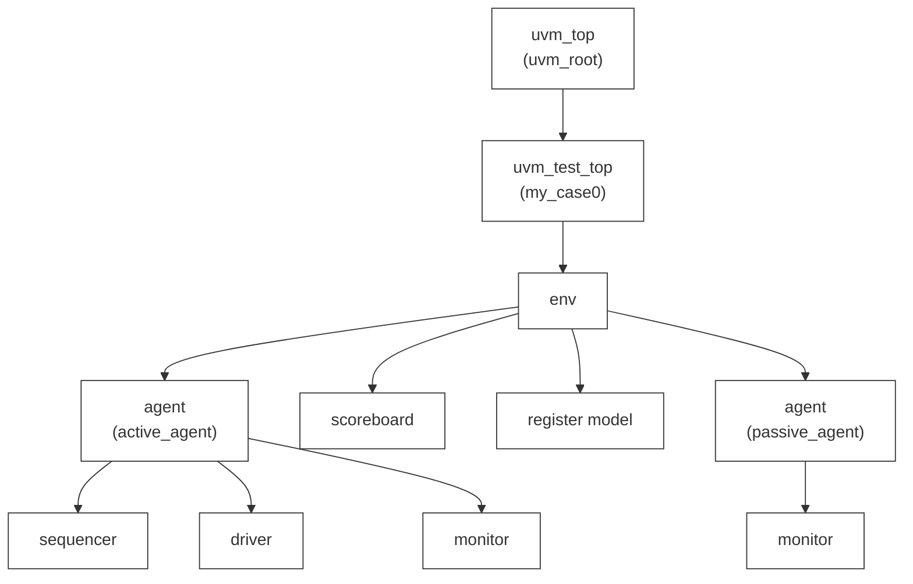

## 概览

1. 验证方法学
2. UVM中常用类的继承结构
3. 验证平台框架
4. UVM的调用

- SV发展1：URM -> AVM -> OVM -> UVM1.0 -> UVM2.0
- SystemC：TLM1.0 -> TLM2.0
- SV发展2：VMM1.0 -> VMM2.0
- vera: RVM
- 标准：IEEE 1800.2-2020 Universal Verification Methodology (UVM)

>问：为什么使用UVM？
>答：1、UVM指导验证工程从DUT的Spec出发，制定验证计划，测试点分解，创建测试用例，定义验收(sign-off)方式和标准，流程自动化和报告自动化等等。
>	2、提供一套标准类库，可提供具有高复用性和高性能架构的验证环境所需基本模块。

验证流程：
1. 设计规范（Specification）
2. 制定验证计划（Verification Plan）
3. 分为三个流程
	1. 验证环境搭建（Verification Env Building）
	2. 定向/随机测试用例（Directed/Random Test Case）
	3. 功能覆盖率规划（Functional Coverage）
4. 仿真+回归+覆盖率收集（Simulation+Regression+Collect Coverage）
5. 覆盖率分析（Coverage Analysis）
6. 满足验收标准？（Sign-off Requirement）
7. 满足则 -> 验收结束（Coverage Analysis）

## 八大机制

1. [[factory机制]]（Override）
2. ConfigDatabase机制
3. Phase机制（仿真开始与结束，不耗费仿真时间）
4. Objection机制（仿真开始与结束，耗费仿真时间）
5. Sequence机制（激励）
6. Reporting机制（报告）
7. 寄存器抽象层（RAL）（利用寄存器模型配置寄存器）
8. 事务级建模（TLM）（组件间传输数据）

## 树状图



- uvm_top是固定的，不可更改，下面的其他构成可以自行更改；
- agent必须在env之下（会报错），但是scoreboard和register model可以在env之上；
- 区分active_agent和passive_agent下的组件；

## 验证平台


- 对应上一节的树状图；
- uvc —— 验证单元/组件：env和agent及其内部组件

如何导入UVM?
```
Tb:
 1、import uvm_pkg::*;
	 `include "uvm_macros.svh" //现在合并，只需要第一行import代码即可
 2、initial begin
	 run_test();
	end	
脚本：
	+UVM+random_seed+
	+UVM_TEST_NAME=case_name
	//不需要2次编译，因为uvm用了关键词$value$plusargs()
```